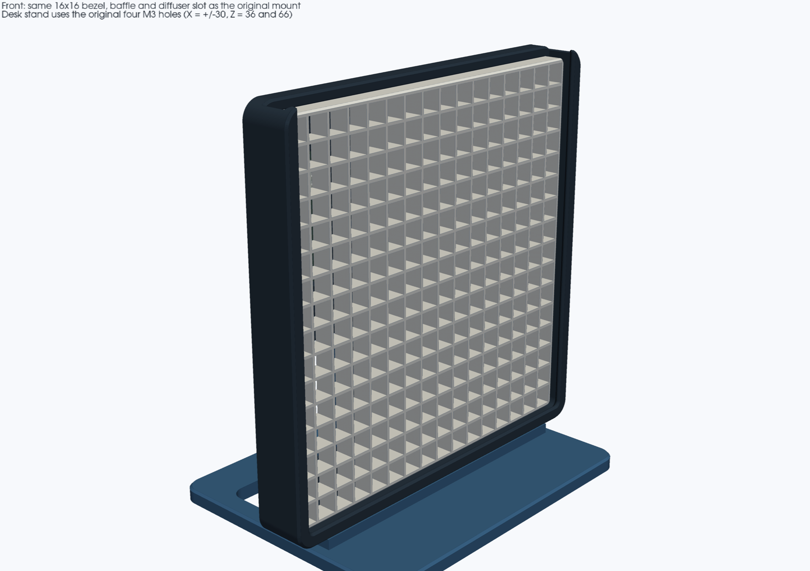
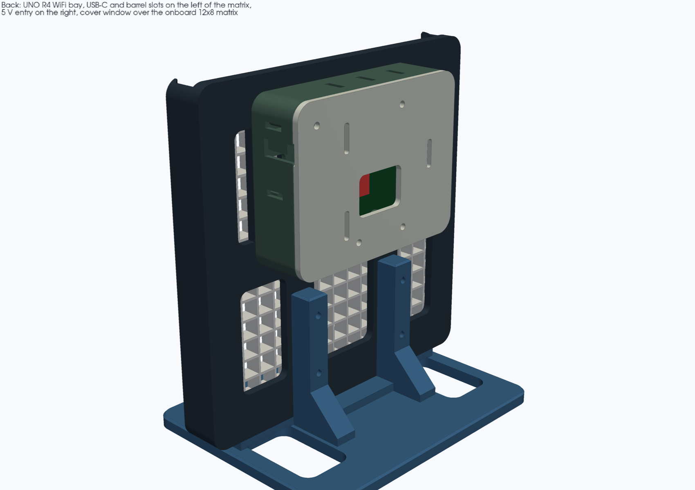
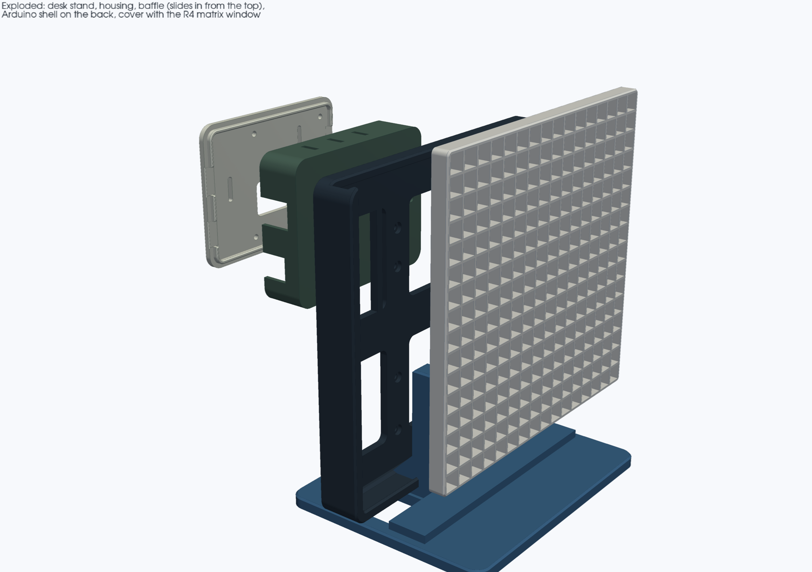
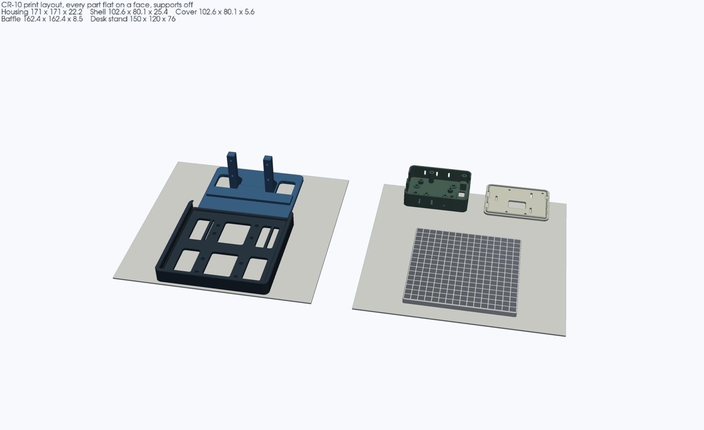

# 16×16 Matrix Housing with a Rear Arduino UNO R4 WiFi Bay

A support-free PLA variant of [`enclosures/matrix_16x16_mount`](../matrix_16x16_mount). The front bezel, 16×16 baffle and 162 mm diffuser slot are unchanged. On the back, a bolted shell holds an **Arduino UNO R4 WiFi** (ABX00087), with a removable cover, a path for the matrix leads, a pocket for the 1000 µF capacitor, and a strain-relieved entry for the external 5 V supply.

The original mount is not modified. This housing still bolts to `matrix_16x16_base_mount` on the button-lamp top deck, and a new desk stand uses that same four-hole pattern.






Modelled with [`nurb`](https://pypi.org/project/nurb/) (build123d), same workflow as the original mount.

---

## Parts

| File | Qty | Envelope (mm) | Print orientation |
|---|---|---|---|
| `stl/matrix_16x16_arduino_housing.stl` | 1 | 171.0 × 171.0 × 22.2 | Flat on its back (`Z = 0`). Same pose as the original housing. |
| `stl/matrix_16x16_baffle_insert.stl` | 1 | 162.4 × 162.4 × 8.5 | Flat on the bed. Dimensionally the same insert as the original mount. |
| `stl/matrix_16x16_arduino_shell.stl` | 1 | 102.6 × 80.1 × 25.4 | Mating face down, cavity up. Standoffs and slots print upward. |
| `stl/matrix_16x16_arduino_cover.stl` | 1 | 102.6 × 80.1 × 5.6 | Plate on the bed, lip up. |
| `stl/matrix_16x16_desk_stand.stl` | 1 | 150.0 × 120.0 × 76.0 | Foot on the bed. Horizontal M3 bores are teardrop-crowned. |

Each part is one watertight solid. Walls are 2.4 mm (the baffle dividers stay 1.2 mm, same as the original, so a 0.4 mm nozzle can print them as three perimeters). The cover lip is 0.3 mm per side smaller than the shell cavity. The baffle keeps the original clearance: 162.4 mm in the 163.0 mm track.

The shell sits on the upper back of the housing (housing Y from −2.4 to 77.7 mm). The original base-mount pillars only touch the backplate up to Y = −20 mm, so the bay clears them by about 18 mm. On the desk stand the shell bottom is 17.6 mm above the pillar tops.

### Slicer

Creality CR-10 (300 × 300 × 400 mm), **PLA**, **0.2 mm** layers, 0.4 mm nozzle, 3 walls, 15–20% gyroid infill, **supports off**. The housing and the baffle are the same size as the original and fit the bed with the shell, cover and stand. Two plates is comfortable; one plate cannot hold the 171 mm housing and the 162 mm baffle together.

---

## Arduino placement

Board outline and holes are taken from Arduino's official ABX00087 files (Gerber `PCB.GM4`, NC drill `PCB-RoundHoles.TXT` tool T8, and `UNO_R4_WIFI.step` on [the UNO R4 WiFi docs page](https://docs.arduino.cc/hardware/uno-r4-wifi)).

| Feature | Value |
|---|---|
| Board | 68.58 × 53.34 × 1.6 mm |
| Mounting holes | Ø3.2 mm, four places |
| Hole centers from the board origin | (13.97, 2.54), (66.04, 7.62), (66.04, 35.56), (15.24, 50.80) mm |

The origin is the corner of the board at the USB/barrel edge and the analog/power edge. X runs 68.58 mm toward the tab on the far end. Y runs 53.34 mm toward the digital header. That origin is placed at housing **(−40, 10) mm**, so:

- USB-C and the barrel jack face the **left** side of the matrix when you look at the LEDs. Both slots are open at the top of the shell wall and capped by the cover.
- The digital header, including **D6**, is along the **top** edge of the board.
- The 5 V lead enters the **right** side of the bay (the wiring bay), through an 8 mm notch, and is zip-tied to the eye just inside.

The onboard 12×8 matrix is centered at board (45.96, 19.18) mm. The cover window is 28 × 20 mm over that cluster (the LEDs themselves span about 24.8 × 16.4 mm).

Standoffs are **M3 heat-set inserts**, not self-tappers. The modelled pilot is **Ø4.1 × 5.0 mm deep** in a 6 mm standoff (Ø8.5 mm boss). That fits a **ruthex RX-M3Sx4.0** or any equivalent M3 insert that is Ø4.6 mm across the knurl and 4.0 mm long (datasheet hole 4.0 mm; the extra 0.1 mm is for a PLA hole that prints small). The UNO holes are Ø3.2 mm, so an M3 screw passes through the board into the insert.

---

## Hardware

| Qty | Item | Where it goes |
|---|---|---|
| 4 | M3×16 socket-head screws | Housing to the desk stand, **or** to the original `matrix_16x16_base_mount` |
| 4 | M3 hex nuts | On the back of those uprights |
| 4 | M3×8 socket-head screws | Housing into the shell (heads recessed under the LED matrix, on the pixel-grid intersections) |
| 4 | M3 hex nuts | Dropped into the hex pockets in the shell floor before the Arduino goes in |
| 8 | M3×4.0 mm heat-set inserts, Ø4.6 mm knurl (ruthex RX-M3Sx4.0 or equivalent) | 4 in the standoffs, 4 in the cover-screw bosses |
| 4 | M3×6 socket-head screws | Through the Arduino into the standoff inserts |
| 4 | M3×8 socket-head screws | Cover into the shell. Heads sit on the outside of the cover |
| 1 | 1000 µF electrolytic, up to Ø12 × 20 mm body | On its side in the channel. A 10×16 or 10×20 can fits; leads come out the open end |
| 1 | Zip tie, about 3–4 mm wide | 5 V lead to the teardrop eye (Ø4.2 mm bore) |
| — | 162 × 162 × 1.0 mm polycarbonate | Same Akamino diffuser sheet as the original mount. One or two sheets |

Do not power the 256 LEDs from the Arduino's barrel-jack regulator. The barrel cutout is there so you can still plug a cable in. The matrix current belongs on the external 5 V lead.

---

## Assembly

1. Melt the eight heat-set inserts in: four down into the standoffs, four down into the cover bosses. Stop flush. The holes are blind.
2. Drop four M3 nuts into the hex pockets in the shell floor.
3. Bolt the shell to the housing with four M3×8 screws. The heads sit in the recesses on the LED side of the backplate, at (±30, 30), (−30, 50) and (30, 60) mm. The shell's floor slot lines up with the upper-right window in the backplate.
4. Seat the UNO R4 WiFi on the standoffs, USB-C toward the slotted wall, and fasten it with four M3×6 screws.
5. Wire the matrix through the floor slot:
   - **DIN → D6** (digital header on the top edge of the board; in the 8-pin half, D6 is the pin next to D7, and D7 is the pin closest to the 10-pin half).
   - **5 V and GND** from the external supply to the matrix power-injection pads and to the Arduino's 5 V and GND pins.
   - Put the 1000 µF capacitor across that 5 V and GND, in the channel, with the leads toward the slot.
6. Bring the 5 V cable in through the notch on the right wall and zip-tie it to the eye.
7. Fit the cover. The lip drops into the shell; the notches in the lip leave the USB, barrel and 5 V openings clear. Four M3×8 screws.
8. Slide the baffle down the top mouth of the housing, then the 162 mm diffuser, same as the original mount.
9. Mount it:
   - **On the lamp:** use the original `matrix_16x16_base_mount` and four M3×16 screws into `top_backer_plate`. The four holes and the cradle height are unchanged.
   - **On a desk:** use `matrix_16x16_desk_stand` and the same four M3×16 screws. Nuts go on the back of the pillars.

---

## Rebuild

```bash
export PATH="$HOME/.local/bin:$PATH"
nurb build
nurb check
nurb export
xvfb-run -a python3 render_views.py
```

`nurb` needs Python 3.13. `measurements.toml` records the board, hole and connector numbers and where each one came from.
