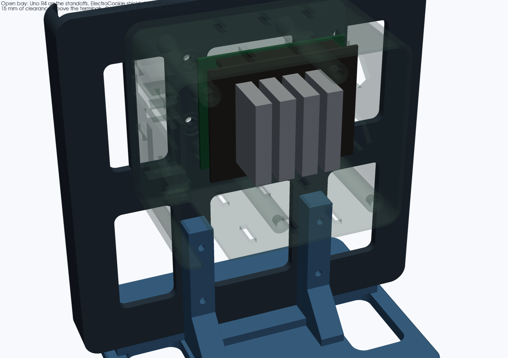

# 16×16 Matrix Housing with a Rear Arduino UNO R4 WiFi Bay

A support-free PLA variant of [`enclosures/matrix_16x16_mount`](../matrix_16x16_mount). The front bezel, 16×16 baffle and 162 mm diffuser slot are unchanged. On the back, a bolted shell holds an **Arduino UNO R4 WiFi** (ABX00087) with an **ElectroCookie Uno Terminal Block Shield** stacked on it (EC_PS_UNO_TB_V1). The bay has a removable cover, a path for the matrix leads, a pocket for the 1000 µF capacitor, a strain-relieved entry for the external 5 V supply, and a strain-relieved exit for the arcade-button wires.

The shield is stacked, not sat beside the Uno. It is an Uno-footprint board with stacking headers on the long edges, so it shares the four mounting holes and does not ask the bay to grow a second board's worth of floor. A side-by-side mount would need another set of standoffs and about 70 mm of extra bay, which will not fit on the 171 mm housing without running into the lamp pillars. The height does fit: the shell is 60 mm deep, and the CR-10 has 400 mm of Z. The kit's 20-pin ribbon and nylon standoffs are not used in this bay. The stacking headers are the connection. Plugging the ribbon into the 2×10 header under the cover would use up the 15 mm of room above the terminals.

The original mount is not modified. This housing still bolts to `matrix_16x16_base_mount` on the button-lamp top deck, and the desk stand uses that same four-hole pattern.





Modelled with [`nurb`](https://pypi.org/project/nurb/) (build123d), same workflow as the original mount.

---

## Parts

| File | Qty | Envelope (mm) | Print orientation |
|---|---|---|---|
| `stl/matrix_16x16_arduino_housing.stl` | 1 | 171.0 × 171.0 × 22.2 | Flat on its back (`Z = 0`). Same pose as the original housing. |
| `stl/matrix_16x16_baffle_insert.stl` | 1 | 162.4 × 162.4 × 8.5 | Flat on the bed. Dimensionally the same insert as the original mount. |
| `stl/matrix_16x16_arduino_shell.stl` | 1 | 102.6 × 86.3 × 60.0 | Mating face down, cavity up. Standoffs, nut pockets, port crowns and vents print upward. |
| `stl/matrix_16x16_arduino_cover.stl` | 1 | 102.6 × 86.3 × 5.6 | Plate on the bed, lip up. |
| `stl/matrix_16x16_desk_stand.stl` | 1 | 150.0 × 120.0 × 76.0 | Foot on the bed. Horizontal M3 bores are teardrop-crowned. |

Each part is one watertight solid. Walls are 2.4 mm (the baffle dividers stay 1.2 mm, same as the original, so a 0.4 mm nozzle can print them as three perimeters). The cover lip is 0.3 mm per side smaller than the shell cavity. The baffle keeps the original clearance: 162.4 mm in the 163.0 mm track.

The shell grew to make room for the stacked shield. It was 102.6 × 80.1 × 25.4 mm. It is now 102.6 × 86.3 × 60.0 mm: the same width, 6.2 mm taller in housing Y, and 34.6 mm deeper. The housing stays 171 × 171 mm. The shell sits on the upper back (housing Y from −6.4 to 79.9). The original base-mount pillars only touch the backplate up to Y = −20, so the bay clears them by 13.6 mm. On the desk stand the shell rim is 2 mm inside the foot's back edge; the cover plate, which is 3 mm thick, sticks past that edge by 1 mm.

USB-C and the barrel jack are still on the Uno's connector edge (the left side of the matrix, looking at the LEDs). They are crowned holes in the shell wall, not slots open for the full 60 mm. The crown is 45 degrees, so it prints with the cavity up and no support. The 5 V notch and the button-wire notch stay open at the rim; the cover lip is notched there and the plate caps them.

### Slicer

Creality CR-10 (300 × 300 × 400 mm), **PLA**, **0.2 mm** layers, 0.4 mm nozzle, 3 walls, 15–20% gyroid infill, **supports off**. The housing and the baffle are the same size as the original. The shell and cover grew in one axis (86.3 mm) and the shell is 60 mm tall; all five parts still fit the bed. Two plates is comfortable; one plate cannot hold the 171 mm housing and the 162 mm baffle together.

---

## Why it is stacked

The ElectroCookie shield is the same outline as an Uno, with stacking headers along the long edges and four corner holes. Stacking it on the R4 uses the holes the bay already has. The terminals face up, so the screwdriver and the wires need room above the board, not beside it. That room is `tb_wire_clearance` (15 mm) under the cover. Wire the terminals with the cover off. The 15 mm is what is left once the cover is on, so a lead can leave the top of a terminal and bend toward the exit without being crushed.

The stack, from the shell floor:

| Layer | mm | Where the number comes from |
|---|---|---|
| Standoff | 6.0 | Printed boss, unchanged |
| Uno PCB | 1.6 | ABX00087 |
| Header gap | 11.0 | Conventional stacking header. **Caliper this.** |
| Shield, PCB plus terminals | 24.0 | ElectroCookie drawing, 0.95 in. **Caliper this.** |
| Wire clearance | 15.0 | Design room above the terminal tops |
| **Interior** | **57.6** | Sum. Shell outside height is 60.0 with the 2.4 mm floor |

---

## Arduino and shield placement

Uno outline and holes are taken from Arduino's official ABX00087 files (Gerber `PCB.GM4`, NC drill `PCB-RoundHoles.TXT` tool T8, and `UNO_R4_WIFI.step` on [the UNO R4 WiFi docs page](https://docs.arduino.cc/hardware/uno-r4-wifi)). The shield outline is the ElectroCookie listing drawing for EC_PS_UNO_TB_V1 (Amazon B092LQXSLG): 2.7 × 2.1 × 0.95 in, labeled 68.5 × 53.5 × 24 mm.

| Feature | Value |
|---|---|
| Uno board | 68.58 × 53.34 × 1.6 mm |
| Shield board | 68.5 × 53.5 mm on the drawing. 2.7 in and 2.1 in are 68.58 and 53.34 mm, so those labels are rounded to 0.1 mm. The keep-out uses the larger of the two in each axis |
| Shield height | 24 mm from the underside of the shield PCB to the top of the terminals |
| Header gap | 11 mm from the R4 top face to the shield underside |
| Mounting holes | Ø3.2 mm, four places, the Uno pattern. The shield drawing does not dimension its holes |
| Hole centers from the board origin | (13.97, 2.54), (66.04, 7.62), (66.04, 35.56), (15.24, 50.80) mm |

The origin is the corner of the board at the USB/barrel edge and the analog/power edge. X runs toward the far end. Y runs toward the digital header. That origin is placed at housing **(−40, 10) mm** for both boards, so:

- USB-C and the barrel jack face the **left** side of the matrix when you look at the LEDs.
- The digital header, including **D6**, **D8** and **D4**, is along the **top** edge of the Uno. The shield's stacking headers carry the terminal labels to those pins.
- The four rows of push-in terminals run across the short axis of the shield. Wire entry and the release lever are on the top of each terminal.
- The 5 V lead enters the **right** side of the bay, through an 8 mm notch, and is zip-tied to the eye just inside.
- Matrix DIN, 5 V and GND drop through the floor slot (still the original upper-right backplate window) after a zip tie on the bar at the upper end of that slot.
- The arcade-button leads leave through the notch in the **bottom** wall (housing X = 40) and are zip-tied to the eye inside it. Bottom is toward the lamp when the matrix is standing.

The R4's onboard 12×8 matrix sits under the shield, so the cover no longer has a window over it.

Standoffs are **M3 heat-set inserts**, not self-tappers. The modelled pilot is **Ø4.1 × 5.0 mm deep** in a 6 mm standoff (Ø8.5 mm boss). That fits a **ruthex RX-M3Sx4.0** or any equivalent M3 insert that is Ø4.6 mm across the knurl and 4.0 mm long (datasheet hole 4.0 mm; the extra 0.1 mm is for a PLA hole that prints small). The Uno holes and the shield holes are Ø3.2 mm, so one M3 screw passes through both boards into the insert.

### What Tom should measure

These are the numbers the drawing does not settle. `nurb check` keeps listing the ones marked provisional in `measurements.toml` until a caliper reading replaces them.

| Measure | Model uses | Why it is not settled |
|---|---|---|
| Shield underside to the top of the tallest terminal | 24 mm | The drawing labels 0.95 in (24 mm) beside the terminals. Read here as PCB plus terminals. 0.95 × 25.4 is 24.13 mm. If the arrow is terminals only, the closed bay is about 1.6 mm tighter than 15 mm |
| Seated gap, R4 top face to shield underside | 11 mm | Not published for this kit. A standard stack is 2.54 mm of male-header plastic plus an 8.5 mm stacking-header body. The kit's nylon standoffs are not in the model |
| Shield PCB thickness | 1.6 mm | Not on the drawing. Used only to size the M3×18. The 24 mm height already includes it |
| Barrel jack vs the shield | jack is 11.0 mm tall (CUI PJ-102AH) and the gap is 11.0 mm | If the shield PCB is not notched over the jack, the two meet and the headers will not seat. USB-C is about 3.3 mm tall and clears |
| Shield hole centers | same four as the Uno | The drawing shows corner holes and does not dimension them. Drop the shield on the Uno before printing a second shell |
| Header pins above the shield PCB | assumed shorter than the terminals | If a pin sticks up past the terminal tops, it eats the 15 mm |
| 2×10 ribbon header, if the cable will be plugged in under the cover | not modelled | Leave the ribbon out. An IDC plug is taller than the headroom |

---

## Hardware

| Qty | Item | Where it goes |
|---|---|---|
| 4 | M3×16 socket-head screws | Housing to the desk stand, **or** to the original `matrix_16x16_base_mount` |
| 4 | M3 hex nuts | On the back of those uprights |
| 4 | M3×8 socket-head screws | Housing into the shell (heads recessed under the LED matrix, on the pixel-grid intersections) |
| 4 | M3 hex nuts | Dropped into the hex pockets in the shell floor before the Arduino goes in |
| 8 | M3×4.0 mm heat-set inserts, Ø4.6 mm knurl (ruthex RX-M3Sx4.0 or equivalent) | 4 in the standoffs, 4 in the cover-screw bosses |
| 4 | M3×18 socket-head screws | Through the shield and the Uno into the standoff inserts. 14.2 mm of boards and gap, 3.8 mm of thread in the 5 mm blind hole. An M3×20 bottoms out |
| 4 | M3×8 socket-head screws | Cover into the shell. Heads sit on the outside of the cover |
| 1 | ElectroCookie Uno Terminal Block Shield, EC_PS_UNO_TB_V1, Amazon B092LQXSLG | Stacked on the Uno. The kit's 60 cm 20-pin ribbon, nylon standoffs and short screws stay in the bag |
| 1 | 1000 µF electrolytic, up to Ø12 × 20 mm body | On its side in the channel. A 10×16 or 10×20 can fits; leads come out the open end |
| 3 | Zip ties, about 3–4 mm wide | 5 V eye, matrix-lead bar, and the button-wire eye |
| — | 162 × 162 × 1.0 mm polycarbonate | Same Akamino diffuser sheet as the original mount. One or two sheets |

Do not power the 256 LEDs from the Arduino's barrel-jack regulator. The barrel cutout is there so you can still plug a cable in. The matrix current belongs on the external 5 V lead.

---

## Assembly

1. Melt the eight heat-set inserts in: four down into the standoffs, four down into the cover bosses. Stop flush. The holes are blind.
2. Drop four M3 nuts into the hex pockets in the shell floor.
3. Bolt the shell to the housing with four M3×8 screws. The heads sit in the recesses on the LED side of the backplate, at (±30, 30), (−30, 50) and (30, 60) mm. The shell's floor slot lines up with the upper-right window in the backplate.
4. Seat the UNO R4 WiFi on the standoffs, USB-C toward the crowned wall.
5. Press the terminal shield onto the Uno until the stacking headers are seated. The four holes should line up. If they do not, stop and measure the shield holes before tightening anything.
6. Fasten both boards with four M3×18 screws into the standoff inserts.
7. Wire with the cover off. The terminals take the wire from above. Press the release with a small screwdriver from above, then let it close on the stripped lead.
   - **Matrix DIN → the terminal marked D6.** In the Uno's 8-pin half, D6 is the pin next to D7, and D7 is the pin closest to the 10-pin half. The shield silkscreen is the map; do not guess a row.
   - **Matrix 5 V and GND** from the external supply to the terminals marked 5 V and GND, and on to the matrix power-injection pads.
   - Put the 1000 µF capacitor across that 5 V and GND, in the channel, with the leads toward the slot.
   - **Red arcade button:** NO → the terminal marked **D8**. COM → a GND terminal.
   - **White arcade button:** NO → the terminal marked **D4**. COM → a GND terminal.
   - Zip the matrix leads to the bar on the floor slot, then drop them through the slot.
   - Bring the button leads out the bottom-wall notch and zip them to the eye.
8. Bring the 5 V cable in through the notch on the right wall and zip-tie it to that eye.
9. Fit the cover. The lip drops into the shell. The notches in the lip leave the 5 V and button openings clear. Four M3×8 screws, at (−34, 4.4), (10, 4.4), (−14, 69.2) and (40, 69.2).
10. Slide the baffle down the top mouth of the housing, then the 162 mm diffuser, same as the original mount.
11. Mount it:
    - **On the lamp:** use the original `matrix_16x16_base_mount` and four M3×16 screws into `top_backer_plate`. The four holes and the cradle height are unchanged.
    - **On a desk:** use `matrix_16x16_desk_stand` and the same four M3×16 screws. Nuts go on the back of the pillars.

Leave the 20-pin ribbon unplugged. The stacking headers already join the shield to the Uno.

---

## Rebuild

```bash
export PATH="$HOME/.local/bin:$PATH"
nurb build
nurb check
nurb export
xvfb-run -a python3 render_views.py
```

`nurb` needs Python 3.13. `measurements.toml` records the board, hole, shield and connector numbers and where each one came from. `nurb check` prints every value still marked provisional.
