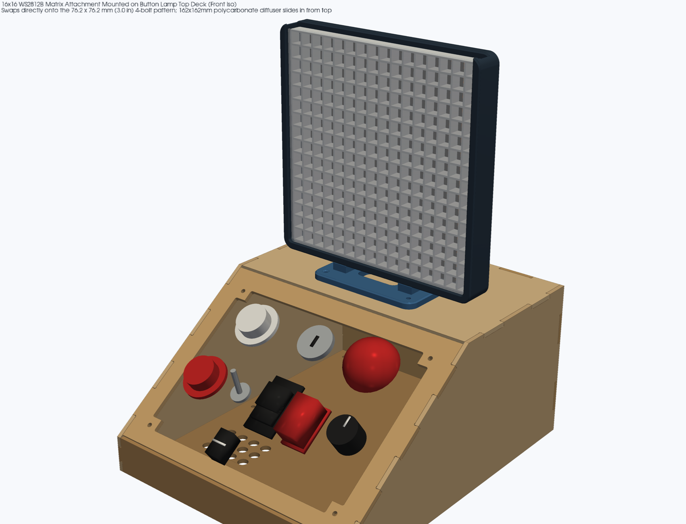
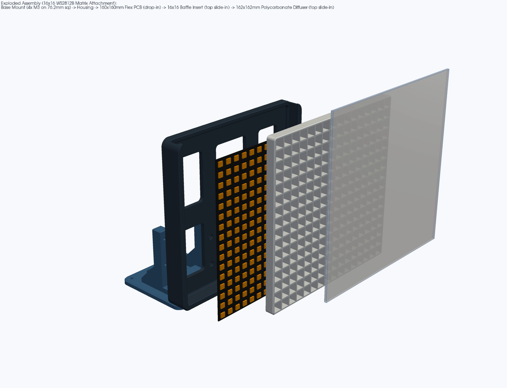
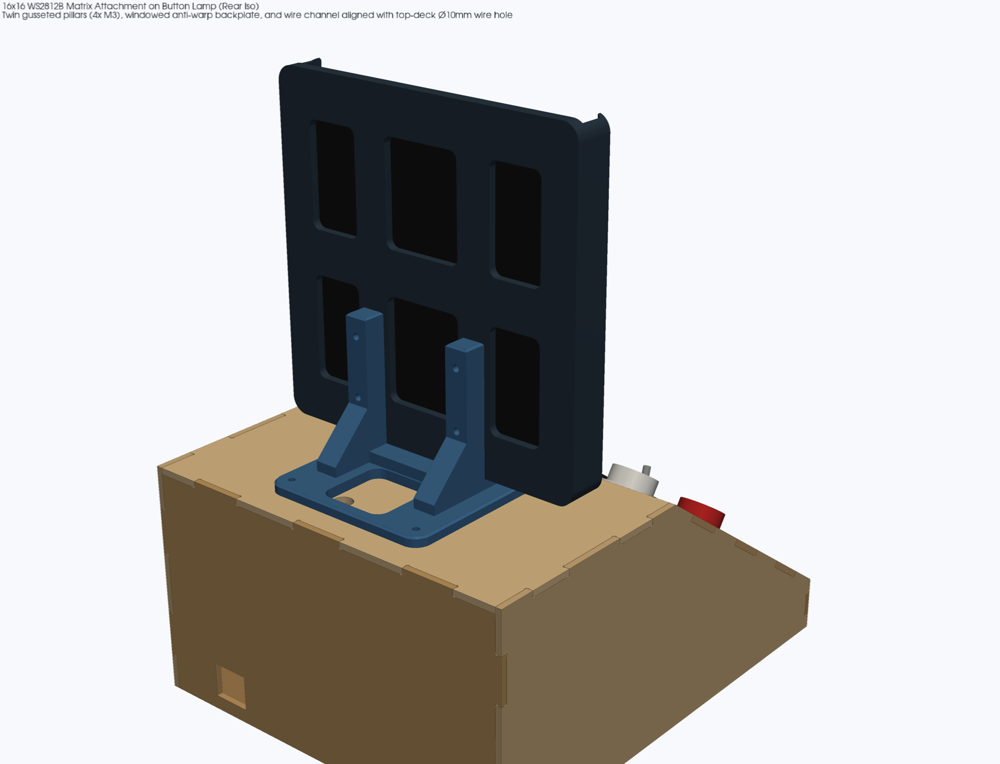
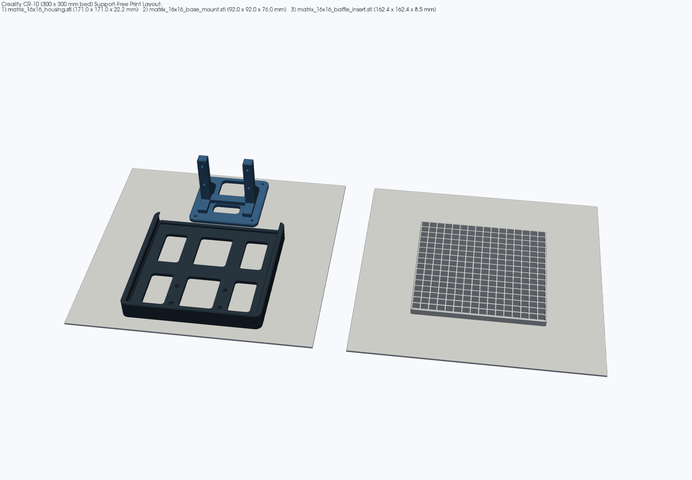

# 16×16 WS2812B LED Matrix Top-Deck Attachment (3D Printable, CR-10 Support-Free)

Swappable 3D-printable attachment that mounts a **BTF-LIGHTING 16×16 WS2812B flexible LED matrix (`160 × 160 mm`, ASIN `B01DC0IOCK`)** and a **`162 × 162 × 1.0 mm` Akamino polycarbonate diffuser sheet** onto the Button Lamp's top deck in place of the spiral neon-tube cage.

All three printed parts are designed with [`nurb`](https://pypi.org/project/nurb/) (`measurements.toml` + `parts/*.py`) and print **100% flat on the Creality CR-10 (`300 × 300 × 400 mm` bed, PLA, `0.4 mm` nozzle) with zero supports**.






---

## 1. Verified Hardware & Top-Deck Dimensions (`measurements.toml`)

| Feature | Dimension | Source / Notes |
|---|---|---|
| **Top-deck flange outline** | `92.0 × 92.0 mm` (`R8.0` corners) | Matches `spiral_cage_tube13mm.stl` and `top_backer_plate.stl` (`plywood/src/spiral.py`) |
| **Top-deck 4-bolt pattern** | `76.2 × 76.2 mm` (`3.000" × 3.000"`) square (`±38.1 mm`) | `4 × Ø3.4 mm` M3 clearance holes verified in `fj125_top_qty1_mm.dxf` and `sm_al063_hood_qty1_mm.dxf` |
| **Top-deck wire pass-through** | `Ø10.0 mm` at `(+11.71, +32.24) mm` from bolt center + `(0, 0)` center | Base mount provides a `36 × 37 mm` rear wire bay (`Y = +3 .. +40 mm`) covering the SendCutSend laser-cut wire hole at `(+11.71, +32.24) mm` **plus** a `36 × 17 mm` front-center wire bay |
| **LED Matrix PCB** | `160.0 × 160.0 mm` (`2.5 mm` pocket height) | BTF-LIGHTING WS2812B 16×16 256-LED flexible FPCB (`B01DC0IOCK`); `161.0 × 161.0 mm` (`0.5 mm`/side clearance) captive lower pocket |
| **Pixel Grid Pitch** | `10.0 mm` center-to-center (`16 × 16` cells) | `1.2 mm` internal divider walls (3 perimeters at `0.4 mm` nozzle), `8.8 × 8.8 mm` cell openings over each `5.0 × 5.0 mm` 5050 RGB LED, `8.5 mm` optical mixing depth |
| **Polycarbonate Diffuser** | `162.0 × 162.0 × 1.0 mm` (1 or 2 stacked sheets) | Akamino `0.039"` (`1.0 mm`) polycarbonate sheet, score-and-snap to `162 × 162 mm`; slides down the `163.0 mm`-wide × `2.5 mm`-deep front track from the open top edge |

---

## 2. Printable Files (Cura `.stl` + `.3mf`)

Slice directly in **UltiMaker Cura** for the **Creality CR-10** (`300 × 300 × 400 mm`, PLA, `0.4 mm` nozzle, `0.20 mm` layer height, 3 walls, 15–20% gyroid/grid infill, **Supports: OFF**):

| File (`stl/` & `3mf/`) | Qty | Envelope (mm) | Volume | Triangles | Print Orientation (As Exported) |
|---|---|---|---|---|---|
| `matrix_16x16_housing.stl` | 1 | `171.0 × 171.0 × 22.2` | `121.5 cm³` | 10,378 | **Flat on its back (`Z = 0`)**, zero supports. All internal pocket steps and front bezel lips use 45.0° self-supporting corbels. Windowed backplate keeps first-layer area under `19,100 mm²` to prevent corner lift. |
| `matrix_16x16_baffle_insert.stl` | 1 | `162.4 × 162.4 × 8.5` | `55.4 cm³` | 6,148 | **Flat on bed (`Z = 0`)**, zero supports. Pure vertical extrusion (`1.2 mm` walls = 3 perimeters at `0.4 mm` nozzle). Print in matte white or black PLA (black maximizes pixel contrast; white boosts brightness). |
| `matrix_16x16_base_mount.stl` | 1 | `92.0 × 92.0 × 76.0` | `66.7 cm³` | 6,294 | **Flat on its `92 × 92 mm` flange (`Z = 0`)**, zero supports. Twin upright pillars carry 45° rear gussets and 45° teardrop-crowned horizontal M3 bores. |

---

## 3. Assembly & Swap Instructions

### Fasteners Required
- **Housing to Base Mount**: `4 × M3 × 16 mm` socket-head or button-head cap screws + `4 × M3` hex nuts.
- **Base Mount to Lamp Top Deck**: Uses the **same `4 × M3 × 16 mm` screws** and under-deck `top_backer_plate.stl` (`4 × M3` nuts) as the spiral coil cage.

### Step-by-Step Assembly
1. **Prep the Diffuser**: Score and snap one (or two stacked, for extra diffusion) **`162.0 × 162.0 mm`** square from the `1.0 mm` (`0.039"`) Akamino polycarbonate sheet using a straightedge and utility knife, and peel the protective film from both sides.
2. **Insert M3 Housing Screws**: Drop `4 × M3 × 16 mm` screws into the four recessed counterbores inside `matrix_16x16_housing` (`X = ±30.0 mm`, `Y = -60.0` and `-30.0 mm`) so their heads sit flush below the PCB pocket floor and the threads point out the back.
3. **Bolt Housing to Base Mount**: Rest the bottom edge of `matrix_16x16_housing` on the front cradle shelf (`Z = 10.5 mm`) of `matrix_16x16_base_mount`, pass the four M3 screw shafts through the twin upright pillars, and secure with `4 × M3` hex nuts on the flat rear faces of the pillars.
4. **Seat the 16×16 WS2812B Flexible PCB**:
   - Feed the rear 3-pin JST-SM input pigtail and 5V/GND power leads out through the lower-center backplate window (`42 × 52 mm`, right between the two upright pillars).
   - Flex the `160.0 × 160.0 mm` PCB slightly to pop it past the front bezel into the captive `161.0 × 161.0 mm` lower pocket (`Z = 4.2 .. 6.7 mm`) so it lies flat against the backplate.
5. **Slide in the 16×16 Pixel Baffle**: Slide `matrix_16x16_baffle_insert` (`162.4 × 162.4 × 8.5 mm`) straight down through the open top mouth of `matrix_16x16_housing` into the rear track (`Z = 7.7 .. 16.2 mm`). It clamps the flexible PCB flat around its perimeter and isolates all 256 LEDs into individual `10 × 10 mm` cells.
6. **Slide in the Polycarbonate Diffuser**: Slide the `162.0 × 162.0 mm` polycarbonate sheet(s) down through the open top mouth into the `2.5 mm` front slot (`Z = 16.2 .. 18.7 mm`) in front of the baffle.
7. **Mount on the Button Lamp Top Deck**:
   - Route the 3-pin data + 5V/GND leads down through the base mount's rear wire bay directly into the top deck's `Ø10.0 mm` wire hole.
   - Bolt the `92.0 × 92.0 mm` flange onto the top deck's `76.2 × 76.2 mm` (`3.000"`) bolt pattern with `4 × M3 × 16 mm` screws into `top_backer_plate.stl`.

---

## 4. Rebuilding from Source

```bash
export PATH="$HOME/.local/bin:$PATH"
nurb build
nurb check
nurb export
xvfb-run -a python3 render_views.py
```
