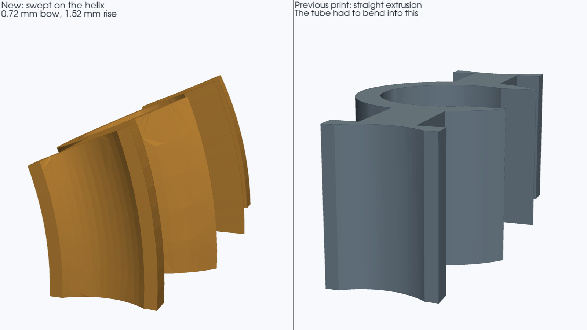
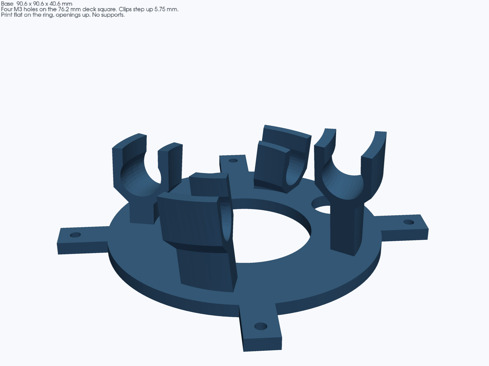
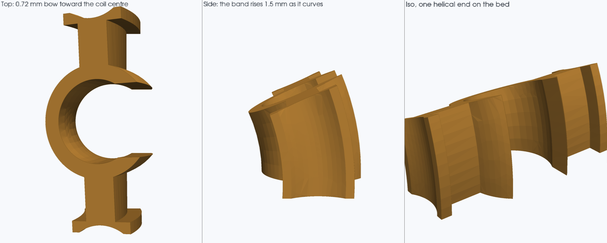
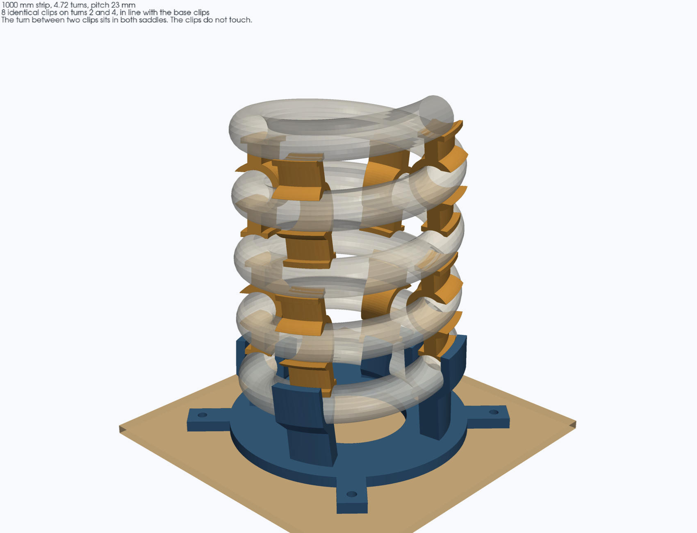
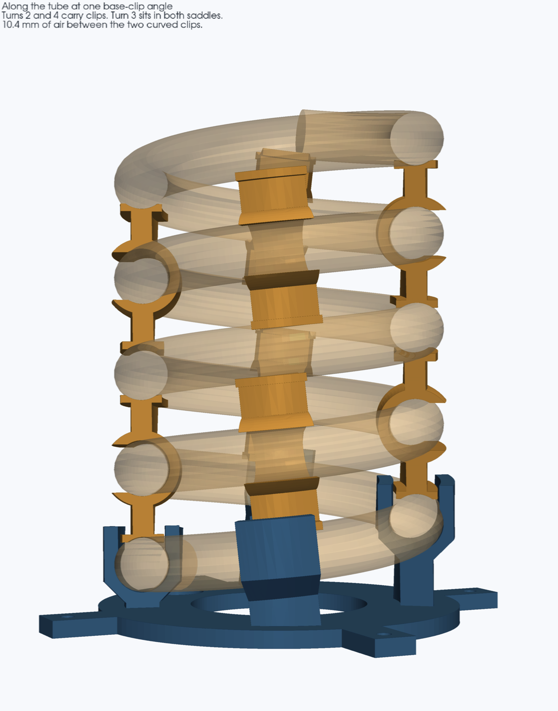
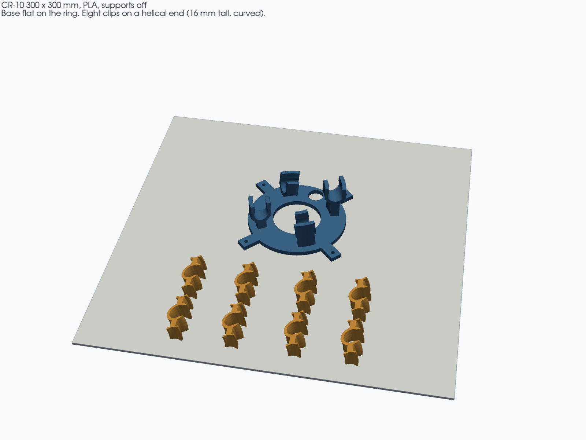

# Spiral tube mount

A support-free PLA mount that holds the button lamp's silicone LED tube in a helix. It replaces the original printed spiral (`Spiral (with base).stl`) and uses the same top-deck screws as the spiral cage and the [16×16 matrix base](../matrix_16x16_mount).

Two parts. The base carries the first turn. Identical clips, printed eight times for a 1000 mm strip, hold the turns above it. The tube is 13 mm silicone with 10 gauge armature wire and a WS2812B strip inside, so it keeps a shape but still needs the clips.

Modelled with [nurb](https://pypi.org/project/nurb/) (build123d), same layout as the other enclosures: `measurements.toml`, `parts/*.py`, `printer.toml`.








---

## Dimensions

| | |
|---|---|
| Coil outside diameter | **80.0 mm** (`coil_diameter`) |
| Coil centre-line | 67.0 mm diameter, radius 33.5 mm |
| Tube | 13 mm OD, bore 13.4 mm, snap mouth 11.5 mm |
| Pitch | **23 mm** (13 mm tube + 10 mm gap) |
| Quarter-pitch step | **5.75 mm** |
| Helix angle | 6.24° |
| Base footprint | **90.6 × 90.6 mm**, 40.6 mm tall |
| Base clip centres | 13.5, 19.3, 25.0, 30.8 mm above the deck |
| One clip, on the bed | **18.0 × 35.6 × 16.0 mm**. The band follows the helix: 0.72 mm of bow and 1.52 mm of rise over the 14 mm length |
| Saddle | arc of a 13 mm circle, 1.2 mm deep, 7.6 mm across, 1.2 mm land each side |
| Coil for a 1000 mm strip | 4.72 turns, 109 mm of rise, top of the tube about 129 mm above the deck |

`coil_diameter` is the outside of the finished coil, tube included. The original printed spiral measures **91.44 mm** outside (`original-plans/3D Printable Parts (STL Files)/Spiral (with base).stl`, Y and Z extents; `plywood/PLAN.md` records the same number, a 22.35 mm tube, and a 68.6 mm centre-line). 80 mm is 12.5 percent under 91.44, the middle of the 10–15 percent Tom asked for. The centre-line only moves from 68.6 mm to 67.0 mm. Most of the change in the outside diameter is the thinner tube.

## Where the screws come from

The mount uses the holes already in the lamp's top deck, the same ones the spiral cage and `matrix_16x16_base_mount` use.

| | |
|---|---|
| Pattern | 4 holes on a **76.2 mm** square (3.000 in), centres at (±38.1, ±38.1) |
| Hole | **Ø3.4 mm**, M3 medium clearance (ISO 273) |
| Wire hole in the deck | Ø10 at **(+11.71, +32.24) mm** from the bolt centre, +X to the right, +Y toward the back |
| Screws | 4 × M3, the same screws as the cage and the matrix base, into `top_backer_plate` |

Sources, in the order that settled it:

1. `plywood/src/spiral.py` — `bolt_sq=76.2`, `bolt_d=3.4`, noted as the original 3 inch pattern, now M3.
2. `enclosures/matrix_16x16_mount/measurements.toml` — the same square and the wire-hole offsets, checked there against `fj125_top_qty1_mm.dxf` and `sm_al063_hood_qty1_mm.dxf`.
3. `plywood/PLAN.md` — the original `Spiral (with base).stl` had **Ø6.35 mm** holes on this same 76.2 mm square, for the old plastic enclosure. The plywood and sheet-metal decks are M3. This mount follows the deck, not that STL.

The base opens a Ø14 window over the deck's Ø10 hole. The 13 mm tube cannot pass through the deck hole. The leads do, and the window is clear so the start of the coil can be pressed down onto the deck. The first clip is 40° past that window and 2.6 mm higher.

## The curve

The first print extruded every clip straight along the helix tangent. Over the 14 mm band the real tube bows **0.72 mm** toward the coil centre and rises **1.52 mm**. The straight bore made the silicone take that bend.

The bore, the snap mouth, and both saddles are now swept along the helix (a Frenet frame, so the opening stays outward and the saddles stay toward the neighbouring turns). The four base clips use that same sweep, so the first turn bends as well as climbs. Measured along each clip, the tube centre stays 6.70 mm from the bore wall, which is the bore radius. The saddle crowns still land on the turns above and below.

## Clips

Four per clipped turn, on the same four angles as the base clips. They are **in line**, not staggered.

Each clip wraps one turn and its saddles cradle the turn above and the turn below. Putting a clip on every turn would park two saddles in the same gap. Skipping a turn fixes that: the bare turn sits in the top saddle of the clip below and the bottom saddle of the clip above, and those two clips miss each other by **10.4 mm**. The turn-2 saddle also clears the base clip's mouth by 0.7 mm.

For the 1000 mm strip (`plywood/src/spiral.py` `strip_len`, 160 LEDs):

| Turn | What holds it |
|---|---|
| 1 | the four base clips |
| 2 | 4 saddle clips |
| 3 | bare, cradled |
| 4 | 4 saddle clips |
| 5 | bare, cradled by the turn-4 saddles, where the strip runs out |

**4 clips per clipped turn, 8 clips total.** A longer tube adds turn 6, then 8, four more of the same clip each time. Print one clip and snap it on the tube before printing the other seven.

## Print

Creality CR-10 (300 × 300 × 400), PLA, 0.4 mm nozzle, 0.20 mm layers, 3 walls, 15% gyroid, **supports off**. Tom slices in Cura. Both parts fit on one plate.

| File | Qty | Size (mm) | On the bed |
|---|---|---|---|
| `stl/spiral_tube_base.stl` | 1 | 90.6 × 90.6 × 40.6 | Ring down, as exported. Mouths face up. |
| `stl/spiral_tube_clip.stl` | 8 | 18.0 × 35.6 × 16.0 | One helical end down, as exported. The band curves up from that face. |

The base mouths stay open upward and the tower sides stay at 45° (they measure 44.7° once the helix tilt is included), so nothing bridges. Each clip's end face is the first layer. From there the band leans at most 15° off vertical, which is the helix turning through the 14 mm length. Supports stay off. No Cura profile is installed in this build environment; the overhang check is the face-normal measurement above, and `nurb check` reports both parts clean.

## Rebuild

```bash
export PATH="$HOME/.local/bin:$PATH"
nurb build
nurb check
nurb export
xvfb-run -a python3 render_views.py
```

`nurb` wants Python 3.13. The sliders are the keyword defaults on the two part functions: `tube_od`, `coil_diameter`, `gap`, `clip_wall`, `snap_opening`, `pad_thickness`, `clip_width`.
