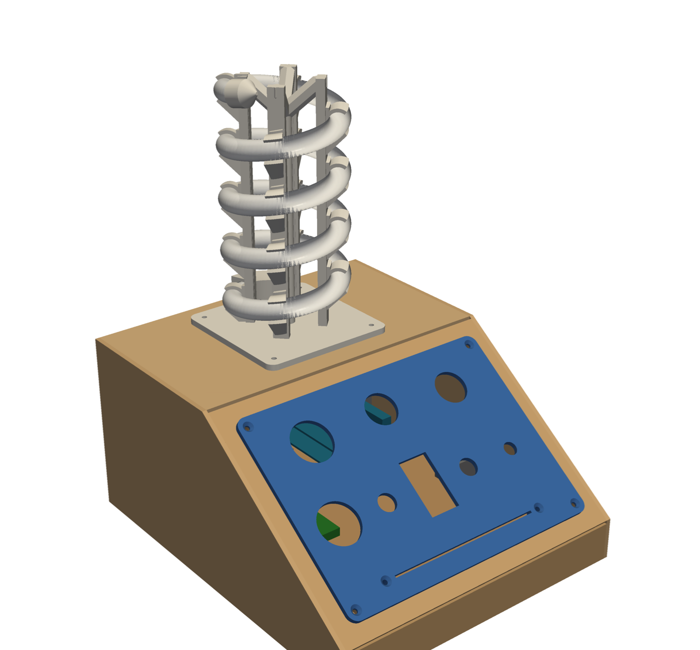
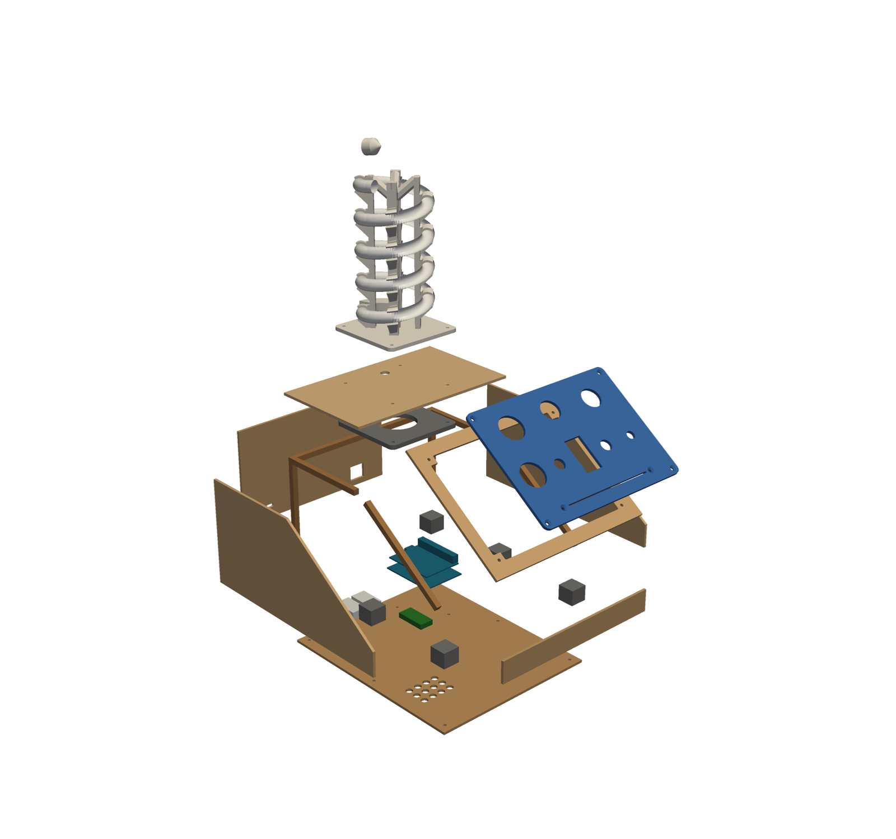
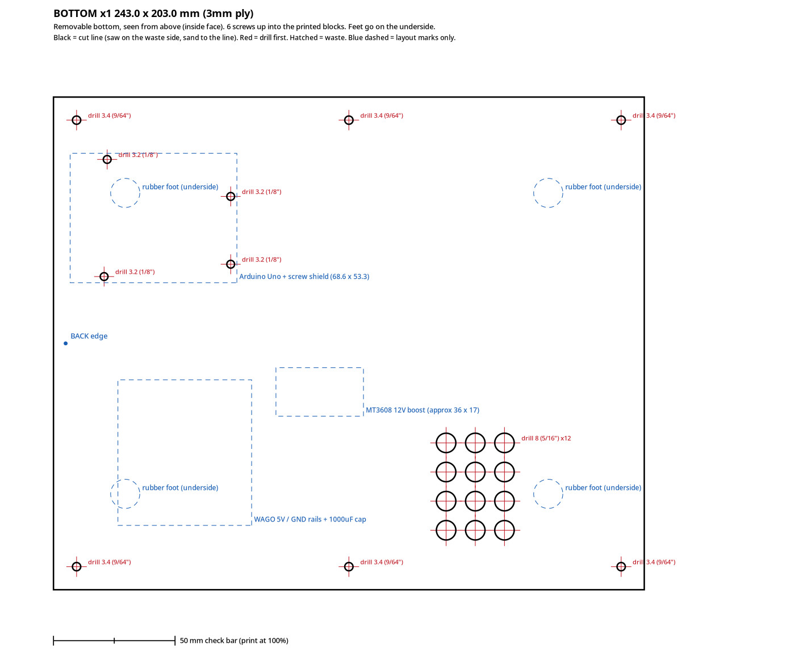

# Spiral Lamp: plywood base + spiral holder for the silicone neon tube

*Plan for Tom, Sun 18 Oct 2026. Everything here lives in `/workspace/buttonbox/plywood/`.*

## 0. Read this first: new strip, tube and LED count

**Revision 2 (Sun 18 Oct 2026).** This revision covers the strip you bought, a holder sized for it, templates laid out for hand cutting, and a USB window in the back. You approved the panel-on-top design.

### The strip you bought (`a.co/d/0bbE4oIe`)

**BTF-LIGHTING FCOB COB WS2812B IC RGB LED Strip, DC5V, 6.5 ft, 320 LED, 5 mm, IP30.** ASIN **B0CNXKQCK4**, model FCOB-5V-160L-W-IP30-SPI-5MM, $18.99, sold by BTF-Lighting and shipped by Amazon. <https://www.amazon.com/dp/B0CNXKQCK4>

These are the options that were selected on the page:

| | From the listing |
|---|---|
| Density | **160 LEDs/m** (1 pixel = 1 IC, individually addressable) |
| Length | **2 m (6.5 ft) = 320 LEDs** |
| PCB width | **5 mm** |
| IC | XGB1338, WS2812B-compatible, GRB colour order, single data line |
| Voltage | **DC 5 V** |
| Coating | **IP30, non-waterproof**: bare FPCB, no silicone sleeve. The white PCB is a plus inside a white diffuser. |
| Cut points | every **12.5 mm (2 LEDs)** |
| Power (listing) | 1 m at mixed white: 15 W, with a 5 V 3 A supply recommended. 2 m: 25 W, with 5 V 6 A recommended. |

**The listing has some inconsistencies:**

- One bullet says "WS2811 IC", but the spec table and title say WS2812B/XGB1338.
- It lists "Material: Silicone" even though it's IP30.
- **It doesn't state the PCB thickness.**

None of these affect the design. The library settings stay `NEO_GRB + NEO_KHZ800`.

### Fit verdict: use the 13 mm tube you linked

| JARBIH tube | Slot | 5 mm FCOB strip |
|---|---|---|
| **"for 5MM", 13 mm OD, B0CKZ2WWJF (your link)** | **6.5 mm** | **Fits.** This is the strip width the tube is sold for, with about 0.75 mm clearance each side, so the strip can't twist. |
| "for 10MM", 16 mm OD, B0CKZ37Y3D | 10.5 mm | Too loose. The 5 mm strip would rattle and roll sideways, and the LEDs would end up pointing anywhere. |

**So there's only one cage STL now, for the 13 mm tube.** A 16 mm version is still one line in `src/build_all.py` (`TUBES`) if you ever need it.

COB strips are also the best match for a round diffuser: there are no dots to see, just a continuous line.

### LED count and power

**Revision 3.** The strip was cut a bit long, so the coil uses the **full metre: 160 LEDs** (80 cut segments, 1000 mm), not the 900 mm / 144 LED cut from revision 2. `LED_COUNT` is 160 in every sketch under `sketches/`. The other metre (160 LEDs) stays as a spare. All 2 m (320 LEDs) still will not run on the Uno.

- The sketch's globals grow with `LED_COUNT`, and NeoPixel also allocates 3 bytes per LED at runtime.
- Compiled for `arduino:avr:uno`. Free RAM is what is left after the globals **and** the LED buffer (`LED_COUNT × 3`):

| `LED_COUNT` | Strip used | Globals (compile) | + LED buffer | RAM left for the stack |
|---|---|---|---|---|
| 144 (revision 2) | 900 mm = 72 cut segments | 1236 B | 432 B | ≈380 B |
| **160 (this build)** | **1000 mm = 80 cut segments** | **1293 B** | **480 B** | **275 B: under 400 B, test every mode** |
| 320 | 2000 mm | ~1850 B | 960 B | **negative: won't run on an Uno** |

The 160-LED build fits, but the stack margin is under 400 B. Test every mode before adding features, and don't add another `LED_COUNT`-sized array.

The holder is **resized for 1000 mm of strip**: 1037 mm of tube (1000 mm strip + 37 mm for the socket and end cap), **4.75 turns**, **19 clips**, and **182 mm** tall. The cage STL was regenerated from that length.

**Power** (5 V 3 A supply):

- The listing's mixed-white figure for 1 m is **15 W, 3.0 A**.
- Worst case, 60 mA per LED at full white, is **9.6 A** at brightness 255. `BRIGHTNESS_CAP 50` (about 20%) brings that to **about 1.9 A**. On the listing's mixed-white figure the same cap is about **0.6 A**.
- Leave the cap at **50**. On this supply, don't take it past **80** (about 3.0 A of full white).
- Keep the 330 Ω on DIN and the 1000 µF across 5 V and GND.

---

## 1. What the original printed parts look like (measured from the STLs)

The plans were clearly drawn in inches: almost every size is a round number of 1/20" or 1/8".

| Part | Size (mm) | Notes |
|---|---|---|
| **Switch Panel.stl** *(the part you printed)* | 184.15 × 133.35 × 3.17 plate (7.25 × 5.25 × 1/8"), plus 6.5 mm bosses underneath | **Confirmed it's the button holder.** Holes: 2 × Ø27.7 (arcade buttons), 2 × Ø22.1 (key switch and mushroom), 2 × Ø12.2 (toggle and covered toggle), 1 × Ø9.1 (speed knob), 1 × 20.95 × 37.85 rectangle (big rocker), and a 106.4 × 1.5 slot (fader) with two Ø6.35 screw bosses 119.6 mm apart. Four Ø3.38 corner holes, 6.35 mm in from each edge, make a 171.45 × 120.65 bolt pattern. That's 9 controls, matching the pin map (D4–D8, D10, D11, A0, A1). |
| **Enclosure.stl** | 245.7 × 198.1 × 116.8 (9.67 × 7.8 × 4.6") | A wedge: flat top 122 mm deep, then a **35.7°** slope down to a ~28 mm front lip. 4.3 mm walls, rounded edges. The sloped face is completely open (184.4 × 133.6) so the panel drops into a ledge. The top has a 91.9 mm square pocket with an 88.9 mm through-hole and 4 × Ø5.8 holes on a 76.2 mm (3") square for the spiral base. Two ~11–13 mm ports at the back bottom corner. Inside volume about 4.0 L. |
| **Spiral (with base).stl** | 168.7 long × 91.44 Ø | A hollow printed tube, **22.35 mm OD, ~1 mm wall**, wound into a coil. Coil outside diameter 91.44 mm, centre-line Ø68.6 mm (radius 34.3), **pitch 27.5 mm**, about **5 turns**, roughly 1.1 m of tube. It stands 164 mm above a 91.44 mm square × 5.08 mm base plate with 4 × Ø6.35 holes on a 76.2 mm square. The tube bore runs into the base plate at a shallow angle, so the plate has a long curved slot where the strip drops into the box. |
| **Spiral End Cap.stl** | 22.6 × 22.4 × 17.0 | A thin (~1.1 mm) hemispherical dome with its rim cut at an angle, so it closes the open top of the coil. |

Pictures: `render/original_Enclosure.png`, `original_Switch_Panel.png`, `original_Spiral_with_base.png`, `original_Spiral_End_Cap.png`, and `original_vs_plywood_side.png` (side by side).

---

## 2. The design in one paragraph

The base keeps the original's wedge shape and slope angle (35.7°), and gets slightly bigger: **250 × 210 × 120 mm (9.84 × 8.27 × 4.72")**. The extra width leaves solid wood around the panel. It's a plain **glued box of 3 mm ply** with butt joints, reinforced inside by **1/4" square basswood glue strips** and **six small printed corner blocks**. Your **printed switch panel sits on top of the sloped board like a faceplate**, held by 4 M3 screws through its corner holes. The window under it is 4 mm smaller than the panel all round, so a wobbly saw cut never shows. The **bottom is removable** and doubles as the **electronics tray**: Arduino, WAGO rails, MT3608 and capacitor all sit on it. Undo 6 screws and the whole lot lifts out. USB-C power and the Arduino's USB port come out the back.

The **spiral holder is one printed "cage"**: four slim columns on a square flange, with snap-in C-clips that hold the silicone tube in a helix. The tube pushes in from the outside. The columns sit *inside* the coil, so from the front you mostly see glowing tube. The flange bolts to the plywood top through a printed backing plate.

### Why the printed cage instead of the other ideas

- **Plywood rib discs on a dowel / stacked plywood helix:** these need dozens of identical angled notches cut by hand. A 13 mm silicone tube is soft, so it needs to be held in a proper C-shape rather than a notch. Lots of fiddly cuts for a worse grip.
- **Central dowel with clip arms:** every arm has to be glued on at a different height and angle. Easy to get wrong, hard to make look neat.
- **Segmented spiral cradle:** a continuous helical channel overhangs everywhere, so it needs supports all the way up, and it hides half the tube.
- **Cage (chosen):** **one print, no supports**, 92 × 92 × 182 mm, so it fits the CR-10 easily. The clips are self-aligning, and every overhang is 45° or steeper. Tube length, turns and pitch are worked out from the 1000 mm (160-LED) strip, so the LEDs fill the coil exactly.

Bonus trick from a reviewer of this tube: if the coil sags between clips, slide a stiff wire (1.5–2 mm aluminium armature wire or coat-hanger wire) into **one of the six outer chambers** before you clip it in. It holds the shape and you can't see it.

### Spiral numbers (13 mm tube, 160 LEDs)

| | New holder | Original |
|---|---|---|
| Coil centre-line radius | 34.3 mm (same as the original) | 34.3 mm |
| Coil outside diameter | 81.6 mm | 91.4 mm |
| Pitch / gap between turns | 34 / 21 mm | 27.5 / 5 mm |
| Turns | 4.75 | ~5 |
| **Tube to cut** | **1037 mm** (1000 mm strip + 37 mm for the socket and end cap) | – |
| Holder height (incl. flange) | 182 mm | 169 mm |
| Bend radius the tube sees | 35 mm | – |
| Clips | 19 | – |

**Bend radius:** the listing doesn't give one. Their photos show it looped much tighter than 35 mm, and inside the coil the strip bends the easy way, flat, as long as its LEDs face **outward** (see step 4 below). Even so, **do a quick test before cutting the tube:** wrap 30 cm of tube *with the strip inside* around a ~70 mm can, light it up, and look for kinks or dark LEDs. If it's unhappy, I can change `R` (coil radius) in `src/spiral.py` to 40 mm. That gives fewer turns and a fatter coil.

---

## 3. Materials

You already have the printed switch panel, the controls, the Arduino Uno with screw shield, the BTF FCOB 5 mm strip (B0CNXKQCK4), the WAGOs, the MT3608, the USB-C breakout (B0C1ZTXZSK) and the 5 V 3 A USB-C supply.

| Item | Qty | Example listing | Notes |
|---|---|---|---|
| JARBIH silicone neon tube **"for 5MM", 13 mm OD** | 1 roll | <https://www.amazon.com/dp/B0CKZ2WWJF> | The one you linked. You need about 1.05 m of the 5 m roll. |
| 1/8" (3 mm) Baltic birch, 12 × 12" sheets | 4 sheets (a 10-pack leaves spares) | TX liteart 10-pack: <https://www.amazon.com/dp/B0CWRNWG6C> | That listing says the sheets are really **11.8 × 11.8"**. The layout is already planned on 299 mm sheets. |
| 1/4" × 1/4" × 24" square strips | 2 sticks (about 0.9 m total) | Bud Nosen basswood 20-pack: <https://www.amazon.com/dp/B092D3GTG1> or Woodpeckers square dowels: <https://www.amazon.com/dp/B09SS3GDF8> | For the glue strips. |
| M3 stainless socket-cap screws + nuts | about 12 screws, 8 nuts | Guard4U M3 kit (6–20 mm): <https://www.amazon.com/dp/B08LW1V2RL> | Panel: 4 × M3×10 + nuts. Spiral flange: 4 × M3×16 + nuts. Bottom: 6 × M3×12 (they self-tap into the printed blocks), or #4 × 1/2" wood screws. |
| M3 nylon standoffs | 4 × 6 mm + screws | Meafeng nylon kit: <https://www.amazon.com/dp/B0CBPGKDP4> | Lifts the Uno off the tray. |
| Stick-on rubber feet | 4 | Bumper Specialties BS22 (9.5 × 5.4 mm): <https://www.amazon.com/dp/B008UFJWZ6> | Leaves an air gap under the vent holes. |
| Wood glue | 1 | Titebond II 8 oz: <https://www.amazon.com/dp/B0000223US> | Wood-to-wood joints. |
| CA gel (super glue) | 1 | Gorilla Super Glue Gel 20 g: <https://www.amazon.com/dp/B087QK383W> | Gluing the **printed** blocks to wood. PVA doesn't stick well to PLA. |
| PLA, white or natural | about 250 g | (your usual) | White or natural PLA makes the clip shadows on the tube much less obvious. |
| Optional: 1.5–2 mm aluminium armature wire | 1.15 m | any | Shape-keeper in an outer chamber of the tube. |
| Optional: clear silicone sealant / RTV | small tube | any | Seals the end cap on and glues the tube end into the socket. |

I couldn't confirm Prime status on every listing from here. The tube page and the Titebond listing show Prime, but check for the badge on the others when you order. I didn't buy anything.

---

## 4. Cut list

### 3 mm (1/8") ply, the main plan

Templates: `templates/ply3mm/`

| Piece | Qty | Size (mm) | Size (inches) | Holes / notes |
|---|---|---|---|---|
| **Side** | 2 | 250.0 × 120.0 profile | 9 27/32 × 4 23/32 | Wedge outline: front edge 28 mm tall, flat top 122 mm deep, slope 35.7°. **Use the template.** |
| **Back** | 1 | 204.0 × 117.0 | 8 1/32 × 4 19/32 | **USB-C power inlet:** 10 × 4.5 slot. **Arduino USB-B window:** 20 × 18, lined up with the Uno's jack. |
| **Top** | 1 | 122.0 × 204.0 | 4 13/16 × 8 1/32 | 4 × Ø3.4 on a 76.2 mm square, centred 61 mm from the back edge. Ø10 wire hole. |
| **Slope (control face)** | 1 | 155.6 × 204.0 | 6 1/8 × 8 1/32 | Window 125.4 × 176.2 with 13 mm square corner tabs left in. 4 × Ø3.4 at the panel's corner-hole spots. |
| **Front** | 1 | 204.0 × 25.5 | 8 1/32 × 1 | – |
| **Bottom (removable)** | 1 | 243.0 × 203.0 | 9 9/16 × 8 | 6 × Ø3.4 screw holes, 4 × Ø3.2 Uno holes, 12 × Ø8 drilled vent holes. Already 0.5 mm undersize all round so it lifts out. |
| 1/4" strip: back/top cross | 1 | 204.0 | 8 1/32 | – |
| 1/4" strip: back corner uprights | 2 | 89.7 | 3 17/32 | – |
| 1/4" strip: side/top | 2 | 102.7 | 4 1/32 | – |
| 1/4" strip: side/slope (under the slope board) | 2 | 131.6 | 5 3/16 | – |

The back, top, slope, front and bottom all fit *between* the two sides, so their widths are 210 − 2 × 3 = 204 mm.

### 6 mm (1/4") ply: what changes

Templates: `templates/ply6mm/`. The outside size stays the same, so the inside pieces get narrower:

| Piece | 6 mm size (mm) | inches |
|---|---|---|
| Side ×2 | 250.0 × 120.0 (same) | 9 27/32 × 4 23/32 |
| Back | 198.0 × 114.0 | 7 25/32 × 4 1/2 |
| Top | 122.0 × 198.0 | 4 13/16 × 7 25/32 |
| Slope | 153.6 × 198.0 | 6 1/16 × 7 25/32 |
| Front | 198.0 × 23.0 | 7 25/32 × 29/32 |
| Bottom | 237.0 × 197.0 | 9 11/32 × 7 3/4 |
| Strips | 198.0 / 83.7 ×2 / 99.7 ×2 / 129.6 ×2 | – |

What else changes with 6 mm:

- Screws get longer: panel M3×12, flange M3×16–20, bottom M3×16 or #4 × 5/8".
- The glue strips become optional: 6 mm edges glue and pin well on their own. Keep the corner blocks, because the bottom screws into them.
- It's twice the weight and much stiffer. You could skip the printed backer under the spiral.
- The 6 mm edges look chunkier. A 1/8" round-over or sanded chamfer helps.
- It's harder on a scroll saw. Use a jigsaw with a fine blade, or a coping saw, and a 10 mm entry hole.

### Hand cutting (scroll saw / jigsaw), already marked on the templates

All joints are **plain butt joints** with glue strips, so every cut is either straight or a single outline. The templates now show:

- **Thick black line = cut line.** Saw on the **waste side** and sand to the line.
- **Red crosshair + size = drill hole.** Ø3.4 (9/64") for M3, Ø3.2 (1/8") for the Uno, Ø10 (25/64") wire hole, Ø8 (5/16") vents. Drill all holes **before** sawing, with a scrap board underneath to stop tear-out.
- **Grey hatched "WASTE" = inside cutout.** Drill the **8 mm (5/16") blade-entry holes** in the red circles, thread the scroll-saw blade (or drop the jigsaw blade in), and saw out. The slope window has 4 entry holes, one in each corner, so you can turn the corners cleanly. The USB-B window has one.
- **Slot (USB-C inlet):** drill **4.5 mm (11/64") at both marked ends**, then saw or file out the 1 mm between them.
- Blue dashed = layout marks only (glue strip positions, the panel outline, tray zones). Don't cut them.

Tips:

- Cut the two sides as a stack, taped together.
- Scroll saw: a #5 reverse-tooth blade for 3 mm ply. Jigsaw: a fine-tooth blade, with the good face down (a normal up-cutting blade splinters the top face).

### Files

- `cutlist.csv` has both thicknesses.
- `templates/ply3mm/*.svg` are full-size single-piece templates in real mm.
- `templates/ply3mm/templates_letter_tiled_ply3mm.pdf` is **the one to print at home**: 11 Letter pages with a 10 mm overlap, a 50 mm crosshair grid for lining up, and a **100 mm and 4 in check bar on every page**.
- `templates/ply3mm/sheet_layout_12x12in.svg` shows how the pieces nest on **4** 12 × 12" sheets.

---

## 5. Printed parts (CR-10, PLA, slice in Cura)

Everything's in `stl/`. I checked that every file is watertight, is a single body, and fits a 300 × 300 bed.

| File | Size (mm) | Qty | Orientation and notes |
|---|---|---|---|
| `clip_fit_test_tube13mm.stl` | 46 × 46 × 79 | 1 | **Print this first.** It's one column with two clips. Snap a scrap of tube in: it should click in and hold without squashing. If it's too tight or loose, tell me and I'll change `bore_clear` or `clip_open_deg`. |
| `spiral_cage_tube13mm.stl` | 92 × 92 × 182 | 1 | **Flange flat on the bed, as exported. No supports.** The clip undersides have 45° gussets and the top spokes are 45°. A 5 mm brim is a good idea because it's tall and slim. 3 walls, normal infill. Clip tops are like small horizontal holes and bridge fine. |
| `end_cap_tube13mm.stl` | 17 × 17 × 17 | 1 (print 2 spare) | **Open end down**, no supports. The cone nose is 45°. Push it over the tube end with a dab of silicone. |
| `top_backer_plate.stl` | 92 × 92 × 5 | 1 | Flat, nut-trap side down on the bed (as exported). Press 4 M3 nuts in. It goes under the plywood top so the 3 mm ply doesn't flex. |
| `bottom_block_x6.stl` | 20 × 20 × 18 | **6** | Flat, as exported. 100% infill or 4+ walls helps the screws bite. There's a 2.5 mm pilot hole for M3 self-tapping or #4 wood screws. |

Volumes, if every part were printed solid: cage 127 cm³, backer 34 cm³, each block 7 cm³. With normal walls and infill they'll weigh less. Cura will tell you the real weight and print time.

---

## 6. Build order

**A. Check the tube and strip (10 min, before anything else)**

1. Slide 30 cm of the 5 mm strip into the 13 mm tube to confirm the fit.
2. Print the clip fit test and snap the tube in.
3. Do the bend test around a ~70 mm can.
4. **Leave the strip at 160 LEDs** (1000 mm, the 80th segment). It was cut long on purpose. If it is still the full 2 m reel, cut on the copper pads at the 80th segment.

**B. Cut the wood**

4b. Print `templates_letter_tiled_ply3mm.pdf` at **100%**. Measure both check bars, tape the tiles together using the crosshairs, and stick them to the ply with a glue stick or spray adhesive.
5. Cut the sides first and clamp them together to sand them identical. Then cut back, top, slope, front and bottom.
6. Drill every red-marked hole first, including the 8 mm entry holes. Then saw out the hatched waste areas with the blade threaded through the entry holes. Then saw the outlines. The window doesn't have to be pretty, because the panel covers it.
7. Cut the 1/4" strips to the lengths in the cut list.

**C. Glue the shell** (wood glue for wood-to-wood, CA gel for printed-to-wood)

8. Lay one side inside-face-up. Glue on the back corner upright, the side/top strip and the side/slope strip, using the blue dashed marks on the template (flip the template for the left side). Do the same on the other side.
9. CA-glue three printed blocks along the bottom edge of each side: back corner, middle and front corner. Line them up flush with the bottom edge and the board positions.
10. Stand the two sides up. Glue in the **back**, then the **front**, then the **top**, which sits on the back board and the strips. Then glue the **slope** board, which runs from under the top board's front edge down over the front board. Use the bottom board, *not glued*, as a squaring jig while it sets. Use tape or rubber bands as clamps.
11. You'll get small V-gaps where the top meets the slope and the slope meets the front. Fill them with wood filler and sand them to a soft round-over, like the original's rounded edges.

**D. Spiral**

12. Cut **1037 mm** of tube, square and clean.
13. Feed the strip in using the built-in pull cord:
    - Tie the cord to the strip's *output* end (the end the arrows point toward).
    - Pull it through until the **input end, with its wires, is at the end of the tube that goes in the socket**.
    - A pinch of talc on the strip helps. One reviewer broke the cord, so pull slowly.
    - **Turn the tube so the LEDs face outward**, away from the cage centre. That way the strip bends flat, the easy way.
14. Cut the 3-pin plug off the input leads, or leave the leads bare. The wire hole is 8 mm.
15. Feed the leads down through the socket's wire channel, then push the tube end about 12 mm into the socket. A dab of silicone holds it.
16. Work up the coil and snap the tube into each clip in turn. Optional: armature wire in an outer chamber first.
17. Trim the top end if needed, leaving about 10 mm past the last LED, and push on the end cap with silicone.

**E. Mount everything**

18. Put the backer plate under the top, with the nuts facing down into the box. Bolt the cage flange through with 4 × M3×16. The wires drop through the 10 mm hole toward the back of the box.
19. Mount the printed switch panel and all its controls. Lay it on the slope, with the **fader edge toward the front (low) edge**, and fix it with 4 × M3×10 and nuts from inside.
20. Build the electronics tray on the bottom (section 7), screw the bottom on with 6 screws, and stick on the feet.

---

## 7. Wiring and space, tied to your pin map

This is the same wiring as before: SpiralLamp_clean V4, inputs on `INPUT_PULLUP`, switches between the pin and GND. The box only changes where things sit.

**Bottom tray layout** (marked as blue dashed zones on `bottom.svg`):

- **Uno + screw shield:** back-left corner, on 6 mm nylon standoffs.
  - Its USB-B jack lines up with the **20 × 18 window** in the back board. The jack face sits 1 mm behind the inside of the back, and the plug only has to reach through 4 mm, so you can reprogram without opening the box.
  - Unplug the USB cable before you drop the tray out. **Unplug the USB-C power first, so the laptop USB and the supply aren't both connected.**
  - Hole positions assume a standard Uno R3. **Hold your board on the template before drilling.**
- **WAGO rails, 5 V and GND:** front-left of the Uno. The 1000 µF cap goes across them, striped leg to GND.
- **MT3608** (about 36 × 17): beside the vents. Fix it with double-sided foam tape and set it to 12 V *before* connecting the covered switch.
- **Vents:** 12 × Ø8 drilled holes beside the MT3608. With `BRIGHTNESS_CAP 50` (about 0.6 A on the listing's mixed-white figure, or about 1.9 A if all 160 LEDs are full white), almost all the heat is in the LEDs outside the box. The vents plus the feet's air gap are plenty.

**Wire runs:**

- **USB-C power inlet (breakout)** goes on the back wall behind the 10 × 4.5 slot, about 14 mm above the floor. Remember the 5.1 kΩ resistors from CC1 and CC2 to GND, or a USB-C charger won't give 5 V. I don't have that board's hole spacing, so mount it to a small ply block with CA or hot glue, or mark its holes from the board itself. **5 V and GND go to the WAGO rails, not through the Arduino.**
- **Strip:** 3 leads come down from the spiral through the 10 mm hole, under the backer, to the tray:
  - 5 V and GND go to the WAGOs.
  - DIN goes through the **330 Ω** resistor to **D9**.
  - Grounds must all be common.
- **Panel harness:** give every control lead about **250 mm** to the screw shield, so you can open the bottom and lay it beside the box.

| Panel control (printed hole) | Pin |
|---|---|
| Jumbo/central rocker, main on/off (rectangle) | **D7** |
| Toggle modifier (Ø12.2) | **D6** |
| Red arcade (Ø27.7) | **D8** |
| White arcade (Ø27.7) | **D4** |
| Key switch, rainbow (Ø22.1) | **D5** |
| Covered toggle with 12 V lamp, wave (Ø12.2) | **D10** |
| Mushroom, chaos (Ø22.1) | **D11**. NC contacts, `CHAOS_ACTIVE_HIGH 1` in the repo version. |
| Fader, brightness (slot) | **A0** |
| Speed knob (Ø9.1) | **A1** |

The covered toggle's lamp gets **12 V from the MT3608**: + terminal to MT3608 OUT+, lamp/GND terminal to GND. Wire D10 as in the earlier covered-switch note, and **check with a meter that D10 never sees 12 V**.

**Clearance:** inside the box is 4.5 L (3 mm ply), a little more than the original's 4.0 L. Under the panel it's the same shape as the original, so anything that fitted under the printed enclosure fits here. The deep parts (mushroom contact block, key switch) sit in the upper half of the slope, where there is roughly 90–110 mm of height under the panel. Keep the tray's electronics in the back half, under the flat top: that's where they're drawn. The very front is only 25 mm tall.

---

## 8. Finishing

- **Sanding:** 120 grit on the edges and filler, then 180, then 220 on the faces. Ease every outside edge with the sanding block. Birch veneer is thin (about 0.5 mm), so don't sand through the face on the corners.
- **Stain or paint:** birch goes blotchy with stain. Use a pre-stain conditioner or gel stain, or skip stain and use a clear satin wipe-on poly, or paint. A dark colour (black, deep blue) makes the glowing spiral pop and hides the joints. Paint the cage too if you like: white looks best behind the tube.
- **Do the printed panel first:** finish it separately, or mask it, before you screw it on.
- **Light leakage:**
  - The spiral sits outside, so the box itself stays dark.
  - The covered toggle's lamp, and the MT3608's little power LED, can glow through gaps. Put tape over the MT3608 LED, and paint the inside edge of the window and the inside of the box matte black if you notice glow around the panel.
  - The flange covers the wire hole, so no light gets out there.
- **Inside the box:** don't varnish where glue or CA goes, and keep finish out of the screw holes in the printed blocks.

---

## 9. Open questions for you

1. **LED count is settled at 160** (1000 mm). The stack margin on the Uno is under 400 B, so test every mode.
2. **Which panel edge faces you?** I assumed the fader slot edge is at the low front. The window and holes are symmetric, so either way works.
3. **USB-C breakout:** can you send the board's size and hole spacing? Then I'll give it screw holes instead of glue.
4. **Your Uno's USB-B position:** the window is 20 × 18 around a standard R3 jack. Hold your board up to the template and check before cutting.
5. **Coil look:** 4.75 slim turns at the original's radius, 182 mm tall. A tighter pitch (about 28 mm) would add a turn and shorten the coil.
6. **Wood finish colour.**

---

## 10. Changing it yourself (or asking me to)

Everything is generated by `src/build_all.py`. Run it with `xvfb-run -a python3 src/build_all.py`; renders need xvfb.

- Tube sizes to build are in `TUBES` in `src/build_all.py`. Coil radius, pitch and strip length are at the top of `src/spiral.py` (`default_params`).
- Box size, ply thickness, lip and tab sizes are in `src/box.py` (`params`).
- `analysis/build_report.json` (written by `build_all.py`) has every computed number.
