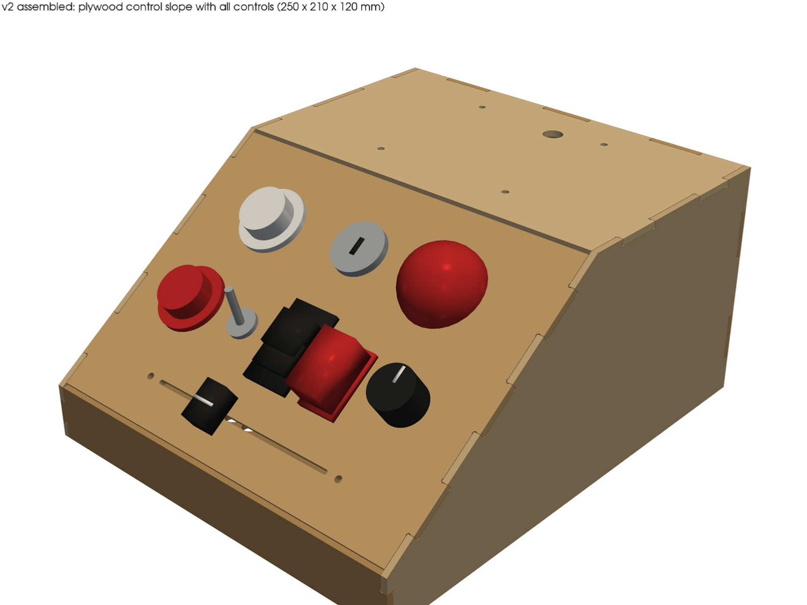
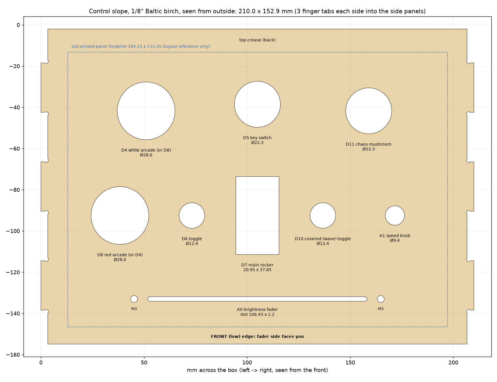

# Finger-joint casing, 1/8" Baltic birch (SendCutSend)

Same outside size as the hand-cut plan, **250 × 210 × 120 mm**, but every panel is laser-cut with tabs that drop into notches in the two sides. Joints, glue-up and assembly order: [ASSEMBLY.md](ASSEMBLY.md).

There are two sets here:

| Set | Folder | What's different |
|---|---|---|
| **v2 (current)** | `dxf/` | The **slope is the control panel**: all 11 control cut-outs go straight through the birch, so there's no 3D-printed Switch Panel. The back gets a **12.2 mm DC jack hole** for the 5 V 10 A supply. |
| As ordered | `dxf/as_ordered_S7872337/` | Exactly what was ordered from SendCutSend (order S7872337). The slope has a window and 4 × M3 holes for the printed panel, and there's no DC jack. |
| Retrofit (optional) | `dxf/retrofit/fj125_faceplate_qty1_mm.dxf` | A 184.15 × 133.35 birch copy of the printed panel with the v2 cut-outs. It screws onto the **already-ordered** slope with the same 4 × M3, so the ordered parts don't go to waste. |

## v2 parts (upload `dxf/*.dxf`, mm, Baltic birch .125")

| Part | Qty | Flat size (mm) | DXF | Change from the ordered set |
|---|---|---|---|---|
| side | 2 | 250.0 × 120.0 | `fj125_side_qty2_mm.dxf` | none |
| back v2 | 1 | 210.0 × 120.0 | `fj125_back_v2_qty1_mm.dxf` | + Ø12.2 DC jack hole |
| top | 1 | 122.0 × 210.0 | `fj125_top_qty1_mm.dxf` | none |
| **control slope** | 1 | 152.9 × 210.0 | `fj125_control_slope_qty1_mm.dxf` | window + 4 holes → 11 control cut-outs |
| front | 1 | 210.0 × 28.0 | `fj125_front_qty1_mm.dxf` | none |
| bottom tray | 1 | 242.65 × 202.65 | `fj125_bottom_qty1_mm.dxf` | none |

You already have the ordered set coming, so for v2 you only need to order the **control slope** (and the **back v2**, or just drill a 12 mm hole in the ordered back at the spot below). Or skip v2 entirely and order only the **retrofit faceplate** for the ordered slope.

`svg/` has an SVG of every DXF. `sheet_layout_v2_24x24in.svg` nests one full v2 set plus the faceplate on a 24 × 24" sheet with 6 mm gaps (for reference or hand-cutting; SendCutSend nests parts itself). `cutlist.csv` has sizes, cut length and pierce counts.

## The control slope

The layout is the printed panel's, hole for hole. Every centre was measured from a section through `original-plans/3D Printable Parts (STL Files)/Switch Panel.stl` (`python3 src/controls.py` re-measures it). The panel's footprint sits where the printed panel used to sit, centred on the slope, with the fader edge at the low front edge.

| Control | Pin | Cut-out (mm) | Printed panel |
|---|---|---|---|
| Arcade, middle left | D8 red (or D4) | Ø28.0 | Ø27.7 |
| Arcade, top left | D4 white (or D8) | Ø28.0 | Ø27.7 |
| Key switch, top middle | D5 | Ø22.3 | Ø22.1 |
| Mushroom, top right | D11 chaos | Ø22.3 | Ø22.1 |
| Toggle, left of rocker | D6 | Ø12.4 | Ø12.2 |
| Main rocker, centre | D7 | 20.95 × 37.85 (long side up the slope) | same |
| Covered toggle, right of rocker | D10 wave | Ø12.4 | Ø12.2 |
| Speed knob, right | A1 | Ø9.4 | Ø9.1 |
| Fader slot, along the front | A0 | 106.43 × 2.2, round ends | 106.43 × 1.52 |
| Fader screws | A0 | 2 × Ø3.4, 119.63 apart | Ø3.2 |

Identical holes are interchangeable. Which arcade is red and which toggle gets the flip cover is up to you; the pins don't care.

**Why the sizes changed slightly:** a laser-cut hole comes out at its drawn size, and birch doesn't flex the way PLA does. So the round holes get about 0.2–0.3 mm of clearance. 22.3 mm is also the standard hole for 22 mm switches. The snap-in rocker's rectangle is kept exact, because snap-ins need a tight hole. The fader slot is widened to 2.2 mm because SendCutSend won't cut anything narrower than 0.08" (2.03 mm) in .125" birch. That's still plenty for a thin fader blade.

### Panel thickness (3.18 mm)

The printed panel was **3.17 mm** thick, so every control was already chosen for a 1/8" panel. The birch is the same thickness:

- **Arcade buttons, key switch, mushroom, toggles, knob:** these are nut-fixed, and 3.2 mm is well inside their range. No pocket or counterbore is needed.
- **Rocker (snap-in): the one to check.** Snap-in rocker clips are often made for 1–2.5 mm panels. If yours won't latch in 3.2 mm, file a small 45° chamfer (about 1 mm) on the *inside* edge of the cut-out where the clips land. That thins the panel locally. A dab of hot glue from inside also works. Test it in the retrofit faceplate or a scrap first.
- **Fader:** it screws up from underneath with 2 × M3. The printed panel held it on 6.5 mm bosses, so put **6–6.5 mm spacers** (nylon standoffs, or stacked M3 nuts) on the two screws so the lever sticks out the same amount as before.
- Key switch and pot often have an anti-rotation tab. The holes have no notch for it (nor did the print), so snip the tab off or just tighten the nut well.

**Depth:** under the top-row controls there's about 110 mm before the tray, about 74 mm under the middle row and about 45 mm under the fader (`src/check.py` geometry). That's the same as the printed design.

## Back: power and USB

- **DC jack:** a Ø12.2 mm hole centred 72 mm from the left outside edge (seen from the front) and 24 mm up from the bottom. Seen from behind, that's right of centre, just left of the old USB-C slot, and clear of the corner blocks and the WAGO area. 12.2 mm suits a **GX12 2-pin aviation socket** or a **12 mm-thread metal 5.5 × 2.5 barrel jack**. Buy one rated **at least 5 A**. With `BRIGHTNESS_CAP 50`, 320 LEDs at full white draw about 320 × 60 mA × 50/255 ≈ **3.8 A**. A cheap DC-022B barrel jack (8 mm hole) is only rated 0.5–3 A, so avoid it at this current. To use one anyway, set `DC_JACK['d'] = 8.0` in `src/fj.py`.
- **USB:** the 20 × 18 window for the Arduino's USB plug stays. The Uno R4 WiFi's USB-C sits in about the same spot as the R3's USB-B (same board outline and mounting holes), lower on the board, still inside the window. Hold the board up to it before gluing.
- The old 10 × 4.5 USB-C power slot is kept, for the 5 V 3 A USB-C supply in the meantime. Tape over it once you've moved to the DC jack.
- The spiral and the top's cage holes are **unchanged**. The tube length for the 320-LED reel is still to be decided.

## Checks (`check_report.json`, run by `build.sh`)

Both sets pass:

- **DXFs:** read back from file. They're closed LWPOLYLINEs on layer 0, in mm, with no self-intersections, and every cut-out sits inside the outline.
- **Minimum feature:** nothing under 2.03 mm. The narrowest cut is the 2.2 mm fader slot.
- **Joints, checked on the 3D solids:** all 19 tabs have matching slots with 0.30 mm length play and 0.15 mm depth play, and the 28 side fingers clear their gaps by at least 0.15 mm. No slot is left without a tab.
- **Assembly:** no part overlaps another, and the bounding box is 250.000 × 210.000 × 120.000.
- **v2 extras:**
  - All 11 control cut-outs are inside the slope, at least 20 mm from its edges and tabs, with at least 4.9 mm between neighbouring cut-outs.
  - The faceplate's 4 holes land on the ordered slope's 4 holes (0.000 mm error).
  - The DC jack is 17.9 mm from the nearest edge, 22.6 mm from the nearest other cut-out, and clear of the corner blocks.

## Rebuild

`./build.sh` runs `src/fj.py` (DXFs, both sets), `src/check.py`, `src/export.py` (SVGs, sheet layout, cutlist) and `src/render.py`. It needs python3 with numpy, shapely, ezdxf, trimesh, manifold3d, pyvista and matplotlib, plus xvfb-run for the renders. It imports `../src/box.py` from the hand-cut plan for the base geometry. The sheet thickness is `T` at the top of `src/fj.py`. The cut-outs and the rocker size are `ROCKER_CUT` and `CONTROLS` in `src/controls.py`, which the sheet-metal version uses too.
