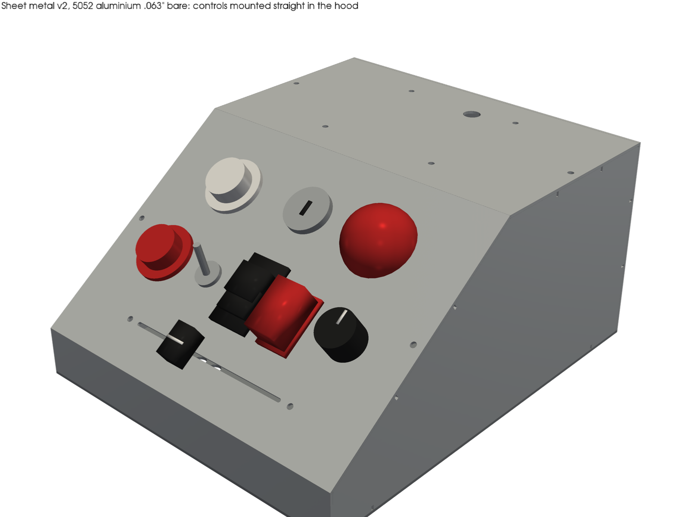
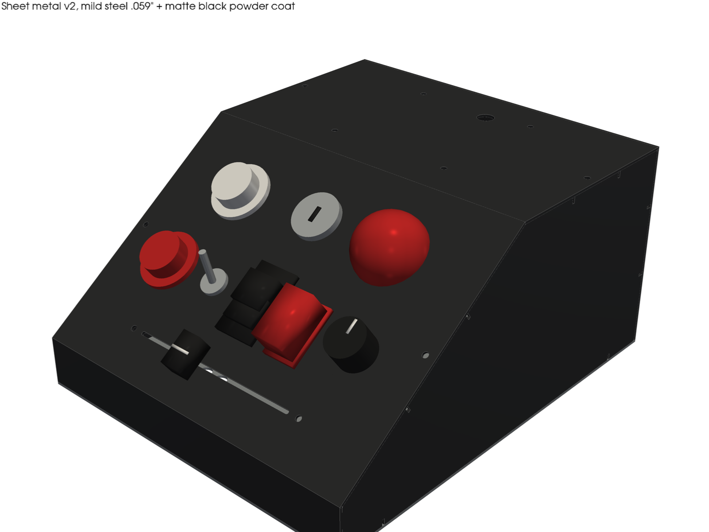
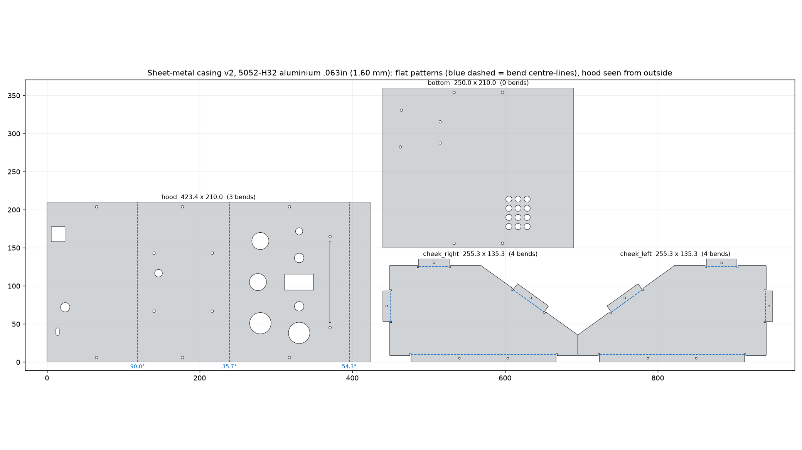

# Sheet-metal casing (SendCutSend, bent)

This is a bent sheet-metal version of the Spiral Lamp casing. It's the same **250 × 210 × 120 mm** wedge as the plywood box, with the controls mounted **straight in the hood's sloped face**. The cut-outs match the plywood control slope exactly, because they come from the same file: [`../plywood/fingerjoint/src/controls.py`](../plywood/fingerjoint/src/controls.py). There's no printed panel.

There are two material variants, each a full set of 4 DXFs in `dxf/`:

- `sm_al063_*`: 5052-H32 aluminium .063" (1.60 mm). Good bare (deburred) or powder-coated.
- `sm_ms059_*`: mild steel (CRS) .059" (1.50 mm). Order it powder-coated, because bare steel rusts.

The flat patterns differ slightly because each uses its own material's bend radius and K-factor.

## Parts (4 per set, 11 bends)

| Part | Flat (mm), Al / steel | Bends | What it carries |
|---|---|---|---|
| **hood** | 423.4 × 210 / 423.2 × 210 | 3: **90°, 35.7°, 54.3°**, all the same direction | back: USB window (Uno R4 USB-C), old USB-C slot, **Ø12.2 DC jack**. Top: 4 × M3 cage holes + Ø10 wire hole. Slope: **all 11 control cut-outs**. 6 × Ø3.4 screw holes into the cheek tabs |
| cheek_right / cheek_left | 255.3 × 135.3 / 255.3 × 135.0 | 4 × 90° each, tabs inward | wedge profile, pulled in by the sheet thickness so it nests inside the hood. Back, top and slope tabs (11 mm, 1 screw each) and a long bottom tab (2 screws). Ø2.5 pilots for M3 thread-forming / #4 sheet-metal screws |
| bottom | 250 × 210 | 0 | removable electronics tray: 4 Uno holes, 12 × Ø8 vents, 4 screw holes into the cheek bottom tabs |

The hood lifts off once you take out 6 screws. Unplug USB first. The cheeks, bottom, back holes and top holes are the same as the Oct 18 quote design. Only the slope face changed (the window became the control cut-outs), and the DC jack is new. The control cut-outs, panel-thickness notes and DC jack choice are explained in [../plywood/fingerjoint/README.md](../plywood/fingerjoint/README.md#the-control-slope).

**Panel thickness in metal:** 1.5–1.6 mm suits every control. Snap-in rockers are made for this thickness, so the 20.95 × 37.85 rocker cut-out should latch firmly. Check your rocker's cut-out before ordering: a small KCD1 needs 19 × 13. The nut-fixed parts just need a washer. Put **8 mm spacers** on the fader's two M3 screws, so its lever stands as proud as it did on the 3.2 mm printed panel with its 6.5 mm bosses.

## SendCutSend bending rules, checked (`check_report.json`, from `src/sm.py`)

| Rule (SCS published) | SCS value | This design | OK? |
|---|---|---|---|
| Bend spec (inside radius / K) | Al .063": R 0.035", K 0.42. Steel .059": R 0.063", K 0.40 | flat patterns computed with these | ✓ |
| Min formed flange (90°) | Al 0.303" (7.7 mm), steel 0.309" (7.85 mm) | smallest is the 11 mm cheek tabs; shortest hood leg 28 mm | ✓ |
| Bend relief | relief depth Al 0.118" (3.0 mm), steel 0.142" (3.6 mm) | 1.6 mm wide notches of that depth at both ends of every cheek tab | ✓ |
| Max bend angle | 130° | 90° / 35.7° / 54.3° | ✓ |
| Part / bend length | max flat 30 × 44"; max bend length 16–44" by thickness | hood 16.7 × 8.3"; longest bend 8.3" | ✓ |
| Cut features ≥ die width / 2 from a bend centre-line (deformation) | die width per gauge (SCS material page) | **≥ 19.8 mm** for every feature. The closest control is the fader screws at 23.4 mm; keep-out used is 8.0 mm (half of the 0.630" die, conservative) | ✓ |
| Smallest hole/cut ≥ 50 % of thickness (laser) | 0.8 mm | smallest cut is the 2.2 mm fader slot; webs ≥ 4.9 mm; ≥ 4.3 mm to any edge | ✓ |
| Flange contact on ≥ 50–60 % of the bend length | – | hood legs run the full 210 mm; tabs are full-width flanges | ✓ |
| Bend lines in DXF | centre-line, dashed, same layer | DASHED LINEs on layer 0 (3 on the hood, 4 per cheek) | ✓ |
| **U/C-channel: base ≥ 2 × flange** | 2 : 1 | back leg (120 mm) and front leg (28 mm) face each other across a 250 mm base with a kink in it | **Borderline.** Let SCS's 3D preview decide. If it refuses, split the hood at the top/slope bend into two parts with a 15 mm overlap |
| Powder coat | needs a hole ≥ 0.063" | every part has holes | ✓ |

## What it should cost (from the Oct 18 2026 quote work, not re-quoted)

These figures come from SendCutSend's instant quote builder on **18 Oct 2026**, using SCS's own template parts made to our sizes, bends and finish (QUOTE), plus estimates built from them (EST). Our DXFs were **not** uploaded. The real parts have more cut-outs than the templates: the v2 hood has 26 pierces and 2.32 m of cut, against 19 and 2.15 m for the quoted design. So expect the real price to land toward the top of each range.

**5052 aluminium .063"**

| Part | Bare + deburr + bends | + matte black powder coat |
|---|---|---|
| Hood (template plate, 3 bends) | **$57.68** | **$99.72** |
| Cheeks × 2, blank | $20.84 at qty 1, **$15.98 each at qty 2** | **$33.93 each at qty 2** |
| Cheek bends (8 total) | **EST +$20–35** (the hood's 3 bends added $11.77) | same |
| Bottom plate | **$30.14** | **$62.01** |
| **Set** | **EST ≈ $150–180** | **EST ≈ $250–290** |

**Mild steel .059":** within a few dollars of aluminium. The plain hood blank was $43.05 (aluminium $42.60), and the bent, powder-coated hood $100.10 (aluminium $99.72). Steel set, bent and powder-coated: **EST ≈ $250–290**.

Quoted arrival for an order placed on Oct 18 was Oct 23 bare and Oct 27 powder-coated. US shipping is free over $39. Upload the DXFs at app.sendcutsend.com (mm) for a real price before deciding.

## Ordering notes

- **Aluminium:** upload `dxf/sm_al063_*.dxf` and choose 5052 .063" → Bending.
  - Hood angles in order: 90, 35.7, 54.3, all the same direction (the DXF is drawn from outside).
  - Cheeks: 4 × 90°, tabs toward the inside.
  - Add powder coat if you want it.
- **Steel:** use `dxf/sm_ms059_*.dxf` with mild steel .059". These flat patterns are drawn for steel's bend spec, so don't mix the sets.
- SCS's 3D preview shows the flange directions before checkout. Check that the hood's front leg folds down and the cheek tabs fold in.

## Rebuild

- `python3 src/sm.py` writes `dxf/`, `svg/`, `cutlist.csv` and `check_report.json`.
- `xvfb-run -a python3 src/render.py` redraws the renders.
- They need numpy, shapely, ezdxf, trimesh, pyvista and matplotlib. Both scripts import `controls.py`, `svgout.py` and `proxies.py` from `../plywood/fingerjoint/src/`.
- The renders draw the bends sharp and leave out the cheek tabs. They're for looks; the DXFs are the real parts.
